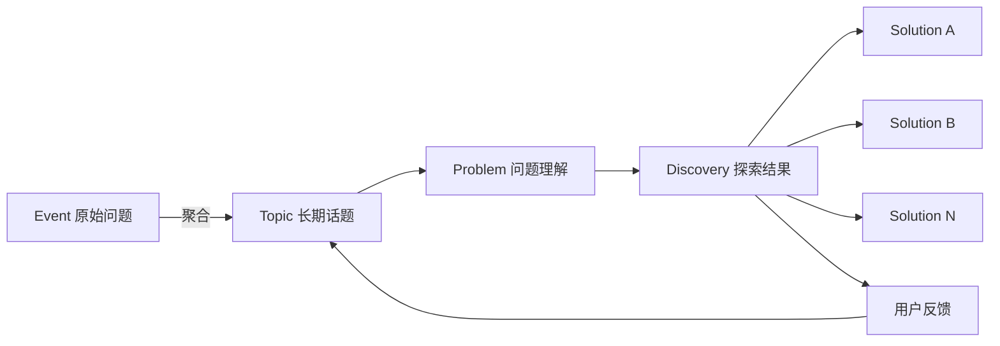
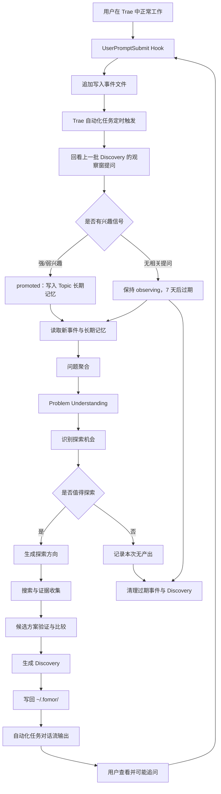
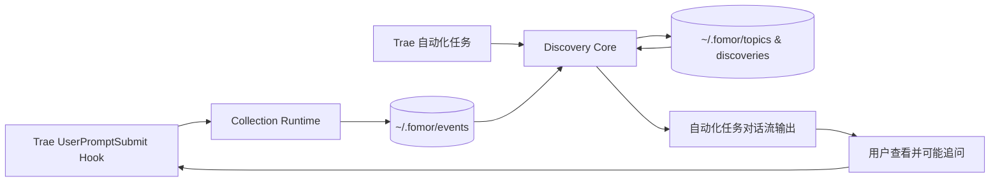

# Fomor 产品需求文档（PRD）

| 项目 | 内容 |
| --- | --- |
| 产品代号 | Fomor（暂定） |
| 版本 | V0.1 |
| 状态 | 产品构想与需求定义阶段 |
| 文档目的 | 记录产品思考过程，明确产品定位、核心机制、功能需求与待验证问题 |
| 关联文档 | [待确认问题清单](./OPEN-QUESTIONS.md)、[Trae 平台能力调研](./TRAE-PLATFORM-RESEARCH.md) |

> 说明：本文由原始构想整理而来，保留全部关键判断与设计意图；原文中重复表述已合并，章节编号已重排。凡涉及平台能力、技术可行性、MVP 边界的内容，以关联文档中的调研结论和问题清单为准。

---

## 一、产品概述

### 1.1 一句话介绍

一个能够持续理解用户工作与学习过程，并从中发现新技术、新方法和不同解决思路的 AI 探索助手。

它通过分析用户在 Agent 中提出的问题，理解用户正在做什么、想实现什么，以及当前采用的解决方式可能存在什么局限，再主动探索其他可能的解决方案。

它不只是告诉用户有什么新技术，而是帮助用户发现：

> 面对当前的问题，还有没有另一种值得尝试的解决方式？

### 1.2 产品定位

这不是一个传统的信息推荐产品，也不是一个每天推送技术新闻的 AI 助手。

它更接近一个持续运行的、以用户为中心的**解决方案探索系统**。

传统 AI 助手：

```text
用户提出问题 → AI 理解问题 → AI 提供答案
```

本产品增加一个新环节：

```text
用户持续工作与提问 → 系统理解用户正在解决什么 → 识别值得探索的问题
→ 主动寻找其他解决方案 → 将有价值的探索结果交给用户
```

区别在于：传统 AI 助手主要帮助用户解决**已经意识到**的问题；本产品希望进一步帮助用户发现**尚未考虑过**的解决路径。

### 1.3 核心价值

对用户：

1. **拓展认知边界**：接触当前工作方式之外的新技术、新方法和新思路。
2. **发现更合适的解决方案**：不局限于当前使用的工具和技术栈。
3. **减少重复探索成本**：系统持续理解工作背景，不必每次从零寻找相关内容。
4. **获得启发而非信息堆积**：推荐围绕真实问题展开，而不是追逐热点。
5. **建立持续学习的路径**：一次探索可沉淀为长期有价值的认知与实践。

对产品，最重要的竞争力不应是搜索能力，而是：

- 能否从一系列表面问题中理解用户真正想解决的事情；
- 能否识别当前方案之外有价值的探索空间；
- 能否找到与用户实际场景相关的新方案；
- 能否判断这些方案是否真的值得用户了解。

搜索、推荐、记忆和消息推送都只是实现手段。

### 1.4 V0.1 已确认的实现决策（2026-11-25）

| 决策项 | 结论 | 影响 |
| --- | --- | --- |
| 定时分析 | **直接使用 Trae 自带的自动化任务**，每天凌晨触发（默认 **03:00**，可在配置中修改）；不自建调度器、常驻守护进程或 MCP 交付服务 | 分析由 Trae 定时执行，结果生成在自动化任务的对话流中 |
| 长期记忆 | **存放在用户主目录 `~/.fomor/`**，不使用插件目录，不写入 Trae 目录，不引入数据库 | 避免插件升级或平台清理影响；Topic、Discovery、事件与运行状态全部是本地文件 |
| 结果返回 | **当前版本只依托 Trae 自动化任务的输出**，不做独立 APP、IM 推送或 Trae 内 MCP 浏览面板 | 交付闭环 = 自动化任务执行记录 + 对话流 |
| 反馈 | **次日分析优先回看前一天的提问**：有新兴趣 → 移入长期记忆；无兴趣 → 到期自动删除 | 不新增反馈入口，用 Trae 中的自然追问作为隐式反馈 |
| 独立网页 | **当前不做**；可选生成静态 HTML 日报（本地打开，无服务、无登录、不上传数据） | 网页不解决核心验证，反而增加部署与隐私成本 |
| 采集方式 | 保留 `UserPromptSubmit` Hook 轻量落盘 | 与上述两项共同构成「Hook 采集 → 自动化任务分析 → 对话输出」的最小闭环 |

> 这些是当前版本的产品边界，不代表长期终态。插件目录只放代码与技能，不放用户数据；APP、IM、MCP 等交付形态仍保留在后续版本方向中。

---

## 二、产品是如何一步步形成的

本节保留构想中的关键转折，记录“考虑过什么”以及“为什么改变方向”。

### 2.1 起点：让 AI 主动带来新的知识与技术

最初设想：做一个 Agent 插件，持续了解用户在日常学习、科研和开发中做了什么，然后主动推荐新的技术、工具和知识。

例如：

- 用户正在研究 Agent，系统发现近期出现了值得了解的新型 Agent 架构；
- 用户正在开发数据服务，系统发现一种不同的数据同步方案；
- 用户经常通过 Prompt 调整 Agent 行为，系统发现了一种新的 Agent 控制方式。

出发点：**用户日常使用 AI 时，往往只能接触到自己已经知道如何询问的内容。** AI 能搜索大量信息，但用户需要先知道该搜什么，于是容易形成信息茧房。

### 2.2 转折一：它不是每日新闻推送工具

把产品理解为“每天收集兴趣 → 搜索最新资讯 → 生成日报”存在几个问题：

1. 推荐内容容易变成与用户实际工作无关的热点；
2. 用户每天不一定都有值得探索的新问题；
3. 技术是否值得了解，不能只由发布时间决定；
4. 新闻、工具介绍不等于能帮用户解决问题。

结论：

- **定时运行只是后台机制，不是产品核心交互形态。**
- 不为每天推送而推送；今天没有值得探索的问题，系统可以什么都不做。
- 对“新”的理解扩展为**认知上的新**：最近出现的新技术、用户从未接触过的成熟技术、没考虑过的工作方式、能改变现有解决路径的技术范式。

### 2.3 转折二：从推荐知识转向推荐解决方案

最初考虑交付：新技术、新工具、开源项目、文章、论文、工作流、教程。

但这些内容本身不构成产品价值。例如用户在做后台任务管理，只推荐一个任务队列工具，用户仍需自己理解它能做什么、为什么需要、如何接入、是否适合。

更有价值的交付是：

> 你现在使用的 Cron + 脚本适合简单的定时任务，但如果任务开始出现复杂的状态管理、失败恢复和人工介入需求，可以考虑 Task Queue + Worker，或者持久化工作流引擎。

这才形成一次有价值的探索。工具只是方案的组成部分。

因此核心交付对象从 Knowledge 转向 **Solution**。一个 Solution 至少回答：

- 它解决什么问题？
- 核心思路是什么？
- 工作流程是什么？
- 需要哪些技术或工具？
- 相比当前方案有什么不同？
- 有哪些优势和限制？
- 什么情况下值得采用？

产品不能只搜索与用户当前技术栈相似的工具，而要寻找**不同的解决方式**。

### 2.4 转折三：不依赖过细的用户意图分类

曾考虑把用户问题分类为项目开发、问题排查、技术学习、工具使用、系统部署、工作流优化等。

但分类并不准确：项目开发和问题排查并非独立活动，调试、解决错误、部署和优化本来就是项目开发的一部分。过度依赖标签会把连续的工作过程切割成孤立问题。

更关键的是，分类回答不了真正关心的问题：

> 用户为什么要做这些？他最终想实现什么？当前工作方式是否还有其他可能？

结论：**不把精细化意图分类作为产品核心**，转而关注一串问题之间的联系——这些消息共同反映了用户正在解决什么问题。

### 2.5 转折四：从单条问题理解转向 Problem Understanding

这是目前产品逻辑中最重要的一次转折。

用户一天可能连续提出很多问题，例如：

- 如何将本地 Docker 数据库迁移到 Supabase？
- 某些复杂的数据采集服务是否应该继续留在本地？
- 本地服务如何连接云端数据库？
- 有没有更方便的工具管理这些本地项目？
- 如何让其他应用访问数据采集服务？
- 数据采集任务失败后应该如何处理？

逐条处理会分别推荐数据库迁移教程、Docker 管理工具、API 服务框架和任务调度工具；但这些可能都指向一个更大的目标：

> 如何构建一套稳定、易维护、能够连接云端与本地服务的数据服务架构？

这意味着**先聚合问题，再理解问题**。

初步四层分析模型：

1. **Observed Questions**：用户实际提出了什么问题？
2. **Underlying Goal**：用户为什么要解决这些问题？想实现什么？
3. **Root Problem**：当前阻碍目标实现的核心问题是什么？
4. **Solution Space**：针对这个问题，还有哪些值得探索的解决方案？

需要区分：底层目标是用户想实现什么；根本问题是为什么当前方式无法很好地实现目标。

系统不能为了得到漂亮结论而强行推断根本问题。证据不足时，应保留多个假设，或明确表示暂时无法判断。

> 注：第 4.2 节给出了更细的六层理解模型，二者关系见 [待确认问题 Q-P2](./OPEN-QUESTIONS.md)。

### 2.6 转折五：先判断是否值得探索，再搜索

不能先搜索一大堆内容再挑选，否则容易产生信息噪声。合理顺序：

1. 收集用户一段时间内的问题；
2. 聚合相关问题；
3. 理解用户的目标、现有工作方式和约束；
4. 判断当前问题是否存在值得探索的解决方案空间；
5. 生成具体的探索方向；
6. 再开展搜索；
7. 验证候选方案；
8. 整理为可供用户理解和判断的探索内容。

即：**搜索由问题驱动，而不是由关键词驱动。**

评分对象不是单条消息，而是：用户当前正在面对的问题，是否存在值得探索的其他解决路径。若当前方案已经很好或没有明显探索价值，不必为了生成内容而强行搜索。

### 2.7 转折六：渐进式理解，而不是一开始采集所有数据

- 第一阶段只记录用户主动发送的问题，不记录 Agent 回复，不主动扫描本地项目文件。
- 如果每天的问题已足够清晰，直接分析。
- 如果某个问题缺乏上下文，再利用 `session_id` 按需读取对应会话历史。

好处：减少采集范围、降低存储成本与隐私风险、不必一开始就具备复杂上下文分析能力。

明确边界：**插件不向 Agent 注入指令，不介入 Agent 正常工作过程。** 它是独立运行的后台系统，Agent 平台只是提供用户行为数据的入口。

### 2.8 转折七：从短期记录转向以话题为中心的长期记忆

每天收集问题会产生大量无长期价值的数据：一次性报错、临时语法问题、无关工具咨询、已解决的问题。

但若用户连续几天研究某项技术，或某次探索已影响项目实践，则值得保留。

因此区分两类数据：

- **短期事件记录（Events）**：最近提出的问题，用于近期分析。
- **长期话题记忆（Topics）**：值得持续关注的主题，包括背景、探索进度、反馈和应用情况。

两者不混在一起：原始问题可以过期，但沉淀出的长期话题不应因原始数据清理而删除。

长期记忆也不应无限增长：话题长期无活动可逐步休眠、归档、过期。但**用户没有反馈不等于不感兴趣**，只有明确拒绝才形成负向偏好。

### 2.9 当前形成的产品共识

- 产品核心是帮助用户发现新的解决方案，而不是推荐资讯。
- 新颖性既包括时间上的新，也包括用户认知上的新。
- 用户的问题需要聚合和深度理解，不依赖过细的意图分类。
- 先理解问题、判断探索价值，再搜索。
- 搜索结果需筛选和验证，不能直接转化为推荐。
- 产品独立于 Agent 会话运行，不注入内容、不干预执行。
- MVP 以用户主动发送的问题为主要数据来源。
- 数据采集遵循渐进式原则。
- 短期事件与长期话题分离。
- MVP 使用 JSON 文件存储。
- 后台定时分析是运行机制，不是每日推送的产品目标。

---

## 三、问题现状与产品机会

### 3.1 当前 AI 使用方式的局限

| 问题 | 说明 |
| --- | --- |
| 只能围绕已知问题提问 | 用户需先意识到问题才能提问；不知道某技术/方法存在，就很难主动提出 |
| AI 容易沿当前思路优化 | 已用某技术栈时，AI 倾向于在该栈内找答案，而真正值得考虑的可能是换架构或换解决方式 |
| 日常问题之间的联系被忽略 | 一天内多个问题可能指向更大目标，但单次对话只解决局部 |
| 技术资讯与实际问题有距离 | 用户关心的是：能否解决我现在的问题、为什么值得了解、与现有做法区别、是否要改架构、引入成本 |

### 3.2 真正要解决的核心问题

不是信息不足，而是：

> 用户缺乏一种持续发现自身现有解决路径之外的新可能性的机制。

完整链路：

```text
用户行为 → 问题理解 → 探索机会识别 → 解决方案发现 → 方案比较
→ 用户反馈 → 长期认知沉淀
```

---

## 四、产品目标与非目标

### 4.1 产品目标

| 目标 | 具体说明 |
| --- | --- |
| 持续理解用户 | 从日常问题中识别用户正在进行的活动和探索方向 |
| 发现潜在问题 | 从多个问题中推导底层目标和当前阻碍 |
| 识别探索机会 | 判断是否存在值得了解的替代、互补或新范式方案 |
| 发现新方案 | 搜索和验证能解决实际问题的技术与工作流 |
| 建立长期记忆 | 通过反馈沉淀有价值的话题和探索进度 |
| 减少信息噪声 | 只展示真正值得关注的探索内容 |

### 4.2 非目标（MVP 明确不做）

1. 每日技术新闻、论文或资讯日报。
2. 普通 RSS 聚合与关键词订阅。
3. 根据用户兴趣简单推荐工具。
4. 每条用户消息都自动触发一次搜索。
5. 自动优化或修改用户正在运行的 Agent。
6. 向 Agent 会话注入指令、Prompt 或上下文。
7. 默认扫描用户本地项目文件。
8. 替代 Agent 自身的官方文档查询能力。
9. 自动替用户决定是否采用某个技术方案。
10. 一开始就构建复杂的知识图谱或庞大的个人知识库。
11. 当前版本不做独立 APP、IM 推送、Trae 内 MCP 浏览面板等额外交付端。
12. 当前版本不自建常驻调度服务（定时分析交给 Trae 自动化任务）。

官方文档可在后台作为事实核验和技术证据，但不作为主要推荐内容。

---

## 五、核心概念与数据关系

### 5.1 Event：用户行为事件

系统采集到的一条原始用户问题，记录：

- 用户发送了什么；
- 什么时候发送；
- 来自哪个 Agent 平台；
- 属于哪个 Session；
- 是否已经参与过分析。

Event 是短期数据，不代表长期知识主题。

### 5.2 Topic：长期话题

系统从一系列问题中识别出的、值得持续关注的探索主题，例如：

- Agent 后台任务管理；
- 本地与云端数据服务架构；
- Agent 执行流程与控制机制；
- 自然语言驱动的数据分析。

关系：一个 Topic 可关联多个 Event；一个项目可包含多个 Topic；一个 Topic 也可跨越不同项目。

**Topic 不等同于 Project**，项目只是可选上下文属性。

### 5.3 Problem：待解决的问题

系统理解用户行为后形成的分析对象，描述：

- 当前正在做什么；
- 想实现什么目标；
- 当前采用什么工作方式；
- 遇到了什么阻碍；
- 有哪些可能的根本问题。

Problem 可以是短期分析结果，也可在持续探索后成为长期 Topic 的一部分。

### 5.4 Solution：解决方案（核心交付对象）

不等于工具、技术或开源项目，而是一种完整的解决路径：

| 字段 | 说明 |
| --- | --- |
| Name | 方案名称 |
| Core Idea | 核心思路 |
| Workflow | 工作流程 |
| Components | 所需技术、工具和组件 |
| Advantages | 主要优势 |
| Constraints | 限制和代价 |
| Requirements | 前置条件 |
| Applicability | 适用场景 |
| Relationship | 与当前方案及其他方案的关系 |
| Evidence | 支撑该方案的资料和实践证据 |

### 5.5 Discovery：一次探索结果

围绕某个 Problem 完成一次探索后形成的结果，将问题理解、候选方案、证据和方案比较组织在一起交付给用户。

- 一个 Discovery 可包含多个 Solution；
- 一个 Topic 可随时间产生多次 Discovery。

### 5.6 关系图



---

## 六、核心功能设计

### 6.1 功能一：用户行为采集

**目标**：以低侵入方式持续记录用户正在关注的问题。

#### 6.1.1 数据来源

MVP 优先支持具有 Hook 能力的 Agent 平台，首个适配平台需支持在用户发送消息后执行 Hook。

#### 6.1.2 Hook 设计

**UserMessage Hook**：用户每次发送消息后，Hook 在后台执行：

1. 获取用户消息内容；
2. 获取 `session_id`；
3. 获取时间戳；
4. 获取平台标识及必要元数据；
5. 将事件写入本地队列或事件文件；
6. 结束执行。

Hook 不调用大模型、搜索引擎或执行复杂分析，职责只有一个：**快速记录用户主动发送的问题**。

**SessionStart Hook**：目前不作为必要功能。此前考虑过在会话开始时向 Agent 注入能力说明，后明确不采用。产品不向 Agent 注入内容，也不干预会话。

若未来需通过 SessionStart 获取平台状态或建立采集连接，必须确保不影响会话内容和 Agent 行为，并单独评估必要性。

#### 6.1.3 采集字段

Event 字段（每个字段必须有明确的读取方，否则不落盘）：

- `event_id`：主键，把原始问题与主题、探索结果、反馈证据关联；
- `session_id`：会话定位符，参与去重键，供未来按会话补上下文；
- `timestamp`：分析窗口、按天归档、反馈归因边界的时间依据；
- `user_message`：唯一的内容载体；
- `fingerprint`：`trae + session_id + 规范化问题` 的 SHA-256，防多 Hook 合并执行导致的重复采集；
- `analyzed_at`：区分已参与分析/未分析，避免重复聚合。

明确不落盘：`platform`（单平台硬编码）、`collection_status`（无第二状态）、`related_topic_id`（与 Discovery 的 source_event_ids 重复）、`cwd`/`workspace_roots` 等环境元数据（无读取方且扩大隐私面）。

**不采集**：

- Agent 回复；
- 完整会话历史；
- 项目文件；
- 用户本地环境中的其他无关数据。

#### 6.1.4 按需获取会话上下文

若某个问题无法独立理解，可根据 `session_id` 读取相关会话历史。

例如用户说「那我们还是采用第二种方式吧」，单看没有意义，需要读取前序消息理解「第二种方式」指什么。

该能力依赖平台是否提供历史会话读取接口。需要确认：

- 是否存在对应 API 或 CLI；
- 能否通过 `session_id` 获取历史；
- 能否限制读取范围；
- 是否存在数据保留期限；
- 是否需要额外授权。

无法获取上下文时，系统应保留不确定性，而不是自行补全。

### 6.2 功能二：问题聚合与理解（Problem Understanding）

整个产品最核心的分析能力。目标不是给每条消息打标签，而是从一段时间内的多个问题中，理解用户正在做什么，以及背后共同的目标。

#### 6.2.1 问题聚合

每天对采集到的问题做一次集中分析，判断：

- 哪些问题属于同一探索主题；
- 哪些只是偶然出现的独立问题；
- 哪些可能共同指向更深层目标；
- 是否存在跨项目、跨 Session 的关联。

不能只依赖关键词相似度。例如：

- 「如何把 Docker 数据库迁移到 Supabase？」
- 「本地数据采集服务应该部署在哪里？」
- 「有没有更方便的本地项目管理工具？」

表面主题不同，但可能都与数据服务架构整体设计有关。反过来，同一项目中的两个问题也可能完全无关。

聚合应综合考虑：

- 问题语义；
- 目标一致性；
- 工作流程之间的联系；
- 时间连续性；
- 已有 Topic 的历史背景；
- 必要时补充的 Session 上下文。

#### 6.2.2 问题理解模型（六层）

| 层级 | 名称 | 内容 |
| --- | --- | --- |
| 第一层 | Observed Questions | 用户实际提出的问题，尽量保留原始表达作为证据 |
| 第二层 | User Activity / Context | 用户正在做什么（开发数据服务、搭建 Agent 工作流、研究交互方式、优化现有系统等），不要求精细分类，只为建立背景 |
| 第三层 | Underlying Goal | 用户最终想实现什么 |
| 第四层 | Current Approach | 当前采用的解决方式：工具与技术、工作流程、职责划分、已做出的技术选择、尝试过的方案 |
| 第五层 | Friction / Constraints | 当前方式的阻碍与约束：连接复杂、任务需长期运行、部署维护成本高、技术栈兼容性限制等 |
| 第六层 | Root Problem Hypotheses | 真正值得解决的问题假设，需有证据支持，而非为显得有洞察力而创造宏大问题 |

Root Problem 支持：

- 多个竞争性假设；
- 假设的证据来源；
- 置信度；
- 尚未确认的信息；
- 暂时无法判断的情况。

#### 6.2.3 分析结果示例

原始问题：

- 如何迁移 Docker 数据库？
- 哪些复杂的数据采集服务需要留在本地？
- 如何管理本地项目？
- 本地服务如何连接云端数据库？

系统分析：

| 维度 | 结果 |
| --- | --- |
| 用户正在做什么 | 构建一套由本地数据采集服务和云端数据库组成的数据服务系统 |
| 目标 | 系统稳定运行，同时降低部署和维护成本 |
| 当前方式 | 本地运行部分服务，通过接口与其他应用交互，数据库正在考虑迁移至 Supabase |
| 当前阻碍 | 本地与云端之间的职责边界、服务部署方式和运行管理机制尚未明确 |
| 可能根本问题 | 如何合理划分本地服务与云端基础设施的职责，构建稳定且易维护的数据服务架构 |

需要进一步确认：

- 哪些服务必须依赖本地环境？
- 数据采集任务是否需要持续运行？
- 是否有实时性要求？
- 是否需要多个应用共享数据？

这一步完成后，系统才具备生成探索方向的基础。

### 6.3 功能三：探索机会识别与评分

**目标**：判断哪些问题值得进一步探索，而不是对所有问题搜索。

#### 6.3.1 评分对象

不是单条消息，也不是某项技术是否热门，而是：**用户当前面对的问题，是否存在值得了解的其他解决方案。**

#### 6.3.2 评估维度

| 维度 | 核心问题 |
| --- | --- |
| 解决空间 | 当前问题是否存在不同的解决路径？ |
| 潜在收益 | 新方案是否可能显著改善效率、稳定性或成本？ |
| 认知增量 | 是否可能让用户接触到此前没有考虑过的思路？ |
| 适用性 | 新方案是否与用户当前场景存在实际联系？ |
| 探索必要性 | 用户当前方案是否已经足够好？是否真的需要探索？ |

可形成综合评分，但不建议一开始设置过于复杂的评分体系。系统应允许判断结果为：

- 值得探索；
- 暂时观察；
- 当前没有明显探索价值。

#### 6.3.3 需要避免的错误

- **为了新颖而推荐**：新技术不代表更适合用户。
- **为了推荐而制造问题**：用户当前方案可能已经足够好。
- **过度抽象**：不能因为连续问了几个 Agent 问题，就推断在研某种宏大范式。
- **重复推荐**：已探索且用户明确熟悉的内容，不应反复作为新发现推送。

### 6.4 功能四：解决方案空间探索

关键不是搜索几个相关工具，而是主动思考：**如果不沿用当前解决方式，还可以怎么做？**

#### 6.4.1 四类探索关系

| 关系 | 定义 | 示例 |
| --- | --- | --- |
| Alternative 替代 | 用不同方式解决相同问题 | 当前 Cron → Task Queue + Worker |
| Complementary 互补 | 在现有方案上增加能力 | 保留 Cron，增加任务状态管理与失败通知 |
| Evolutionary 演进 | 需求规模或复杂度增加时的升级路径 | 简单定时任务 → 任务队列 → 持久化工作流引擎 |
| Paradigm Shift 范式变化 | 从完全不同角度重新理解问题 | 不是优化调度机制，而是让任务具备可恢复的执行状态 |

#### 6.4.2 候选方案生成

从 Problem Understanding 结果出发，**先生成探索方向，再开展搜索**。

示例问题：「如何构建稳定、易维护的后台任务系统？」

探索方向：

1. 优化现有 Cron + 脚本方案；
2. 引入 Task Queue + Worker；
3. 使用持久化工作流引擎；
4. 采用事件驱动架构；
5. 将任务拆分为可恢复的状态机。

方案不互斥，可组合：Cron 负责触发，Task Queue 负责分发，工作流引擎负责复杂执行状态。系统需理解方案之间的组合关系。

#### 6.4.3 搜索与证据收集

搜索对象可包括：

- 新兴技术；
- 成熟但用户不熟悉的技术；
- 开源项目；
- 真实工程实践；
- 技术研究与论文；
- 架构设计案例；
- 社区实际使用经验。

优先围绕具体解决方案展开。官方文档可用于核实 API、功能和技术限制，但不作为最终推荐主体。

#### 6.4.4 方案验证

候选方案至少验证：

- 技术是否真实存在；
- 是否有可访问的实现或实践；
- 它解决的问题是否与当前 Problem 对应；
- 宣称的优势是否有证据；
- 是否存在重要限制；
- 是否适合用户当前技术环境。

没有可靠证据的方案不能包装成成熟实践。

#### 6.4.5 方案比较

每个方案说明：核心机制、工作流程、依赖组件、优势、约束、前置条件、迁移成本、适用场景、与当前方案的关系。

最终不应简单得出「A 比 B 好」，而应回答：**在什么条件下，哪种方案更值得采用。**

### 6.5 功能五：探索结果生成（Discovery）

**目标**：将复杂的搜索与分析结果，组织成用户能够理解和判断的内容。不能把搜索结果直接堆给用户。

每次 Discovery 建议包含：

| 模块 | 内容要求 |
| --- | --- |
| 1. 探索标题 | 以用户问题和潜在机会为中心，而非以工具名称为中心。如「当 Cron 任务开始变复杂，你可能需要的不只是一个调度器」 |
| 2. 我观察到了什么 | 说明为什么产生这次探索，引用近期相关问题并说明联系 |
| 3. 你真正可能在解决什么问题 | 呈现对目标、当前方式和潜在根本问题的理解；存在多个假设时明确展示 |
| 4. 一个值得了解的新思路 | 介绍可能改变思考方式的解决路径，包括核心机制和工作流程 |
| 5. 其他可选方案 | 展示替代、互补、演进或范式变化方案，不必每次覆盖全部类型 |
| 6. 与当前方式的区别 | 改变了什么、解决了什么、付出什么代价、是否值得迁移 |
| 7. 证据与延伸资料 | 相关开源项目、研究、案例、技术资料，服务于理解与验证，而非内容主体 |
| 8. 后续探索入口 | 支持继续深入、已了解、暂时不感兴趣、不相关、尝试过、想了解某部分等反馈，也支持补充实际情况 |

### 6.6 功能六：用户反馈与长期记忆

**目标**：让系统逐渐了解用户的认知背景和探索进度。

**反馈来源**：不新增结构化反馈入口。反馈来自**第二天分析时对 Hook 事件的回看**：用户看到昨日 Discovery 后，如果在 Trae 里继续追问、引用、比较或搜索相关方案，Hook 会记录这些提问；次日分析优先识别它们。

#### 6.6.0 时间模型（关键）

时间以**实际运行时刻**为准，而不是自然日零点，避免时区、跨天和漏跑问题。

```text
D0 03:00  Run N
  ├─ 分析 [T(N-1), T(N)) 的新事件
  └─ 生成 Discovery A，状态 = observing
         feedback_due_at = 下一次运行（首次回看）

D0 03:00 → D1 03:00  观察窗
  ├─ 用户白天看到 A，可能在 Trae 中追问
  └─ Hook 持续记录用户提问

D1 03:00  Run N+1（反馈优先）
  ├─ 1. 取所有 observing 且已到回看时间的 Discovery
  │     └─ 用 [delivered_at, now) 内的提问做匹配
  │           ├─ 有强/弱兴趣 → promoted，写入 Topic 长期记忆
  │           └─ 无相关提问   → 保持 observing
  ├─ 2. 分析 [T(N), T(N+1)) 的新事件
  ├─ 3. 生成 Discovery B
  └─ 4. 清理到期仍未 promoted 的 Discovery
```

规则：

1. **先反馈、后分析**：每次运行先处理上一批 Discovery 的反馈，再分析新事件，避免重复推荐。
2. **观察窗按运行时刻计算**：`[delivered_at, evaluation_run_at)`；漏跑一天不会丢反馈，下次运行会一并评估。
3. **每次运行都可回看，升级只发生一次**：记录 `last_evaluated_run_id` 与 `promoted_at`；同一次运行重跑不重复升级，升级后不再回看。
4. **到期清理**：生成后 7 天仍未 promoted 的 Discovery，删除详情，只保留指纹（Topic/方案关键词的哈希）90 天，避免重复推荐。
5. **迟到的兴趣不算反馈**：超过 7 天再提问，视为新事件，不追溯已删除的 Discovery。
6. **时间统一存 UTC**，同时记录用户本地时区；展示时再转本地时间。

#### 6.6.1 反馈信号（回看窗口内）

| 次日观察窗内的行为 | 判定 | 处理 |
| --- | --- | --- |
| 再次提到同一方案、话题、链接或关键词 | 强兴趣 | `promoted`，写入 Topic 长期记忆 |
| 追问细节、要求继续深入、比较同一方向 | 强兴趣 | `promoted`，更新探索进度 |
| 询问同一 Topic 下的相邻问题 | 弱兴趣 | `promoted`，但证据强度记为「弱」 |
| 明确表示已经了解 | 负向/认知更新 | 更新 Topic 的认知状态，不再重复推荐该内容 |
| 明确表示不感兴趣或不相关 | 负向偏好 | 记录排斥方向；必要时修正 Topic 理解 |
| 实际应用某个方案 | 强正向 | 记录实践进度 |
| 没有相关提问 | 暂不判断 | 保持 `observing`，到期删除 |

特别强调：**沉默不等于不感兴趣。** 没有提问只说明本次探索没有进入用户视野，不能记成负向偏好；它只会让这条 Discovery 自然过期。

匹配方式：Topic 别名、方案名、URL、关键实体、语义相似度。规则命中记强信号；只有语义相似时记弱信号；无法判断时按「无信号」处理，宁可漏判也不过度推断。

#### 6.6.2 Discovery 状态生命周期

```text
observing → promoted
         └→ expired（7 天未 promoted）
         └→ dismissed（用户明确不感兴趣）
```

- `promoted`：摘要与证据写入 Topic，成为长期记忆；
- `expired`：删除 Discovery 详情，仅留 90 天指纹；
- `dismissed`：保留负向记录，不再推荐同类内容。

#### 6.6.3 Topic 长期记忆

每个长期话题建议包含：

- Topic ID；
- 话题名称；
- 背景和上下文；
- 关联项目（可选）；
- 用户关注的目标；
- 当前探索进度；
- 已经介绍过的方案；
- 用户明确表示了解的内容；
- 用户感兴趣的方向；
- 用户明确排斥的方向；
- 已经实践的内容；
- 相关证据和来源；
- 最后活动时间；
- 生命周期状态。

#### 6.6.4 认知状态需要区分证据强度

不能把 AI 推测直接当作用户已掌握的知识：

| 状态 | 证据 |
| --- | --- |
| 明确使用过 | 用户主动说「我之前用过 Temporal」 |
| 明确表示了解 | 用户说「我了解 Temporal 的基本原理」 |
| 仅接触过 | 用户阅读过一次相关探索 |
| 低置信度推断 | 系统推测用户可能熟悉 |

这些状态需要区别保存。

#### 6.6.5 Topic 生命周期

```text
Active → Dormant → Archived → Expired
```

- **Active**：近期持续关注；
- **Dormant**：一段时间没有新活动；
- **Archived**：暂时不再主动参与推荐，但仍可恢复；
- **Expired**：超过保留期限，逐步清理。

具体阈值尚未定稿。初步可考虑 30 天无活动进入 Dormant、90 天后评估归档，但应支持配置并根据实际使用调整。

全局偏好和话题级偏好需分开。例如用户整体喜欢了解新技术，但不想继续研究某个特定方向，两种信息不应互相覆盖。

### 6.7 功能七：定时分析与任务管理

产品不依赖用户每次主动调用 Skill，也不自建常驻后台服务。定时分析直接使用 **Trae 自带的自动化任务（Automation）**。

#### 6.7.1 运行链路

```text
UserPromptSubmit Hook → 追加写入本地事件文件
        ↓
Trae 自动化任务（每天固定时间 / 间隔）
        ↓
① 回看昨天的 Discovery，识别用户提问与兴趣
        ↓
② 有兴趣 → 移入 Topic 长期记忆；无兴趣 → 保持 observing，到期删除
        ↓
③ 分析新事件 → 聚合与理解 → 判断探索价值 → 生成新 Discovery
        ↓
写回 ~/.fomor/，并在自动化任务对话流中输出本次结果
```

各环节职责：

| 环节 | 承担者 | 说明 |
| --- | --- | --- |
| 采集 | Trae Hook | 只做快速落盘，不调用模型、不搜索、不阻塞 |
| 调度 | Trae 自动化任务 | 固定时间（每天/每周/每月）、间隔触发或自然语言自定义 |
| 反馈回看 | 自动化任务中的 Fomor Skill/脚本 | 先评估上一批 Discovery，再分析新事件 |
| 分析 | 自动化任务中的 Agent + Fomor Skill/脚本 | 读取事件与记忆，完成聚合、理解、评分、探索与生成 |
| 记忆 | `~/.fomor/` 下的文件 | Topic、Discovery、事件、运行状态 |
| 返回 | 自动化任务输出 | 结果生成在任务对话流与执行历史中 |

#### 6.7.2 自动化任务的配置约定

**任务由插件 Agent 在用户调用 fomor 技能时代为创建**（Trae 支持在对话中创建自动化任务），不要求用户去界面手动新建。创建时按以下约定：

- **任务内容**：调用 Fomor 的分析 Skill/脚本，明确「先评估昨日反馈 → 再分析新事件 → 输出 Discovery」；完整模板见 `skills/SKILL.md`；
- **触发时间**：每天在配置时间（本地时区，默认 **03:00**）触发一次；此时用户通常不在使用 Trae，观察窗覆盖前一整天；
- **运行模式**：与 Fomor Skill 所在模式一致（Work / Code）；
- **运行环境**：长期记忆在本机 `~/.fomor/`，因此默认选**本地**；但 03:00 大多数电脑处于睡眠，本地任务不会执行。必须配合系统定时唤醒（macOS `pmset`、Linux `rtcwake`/systemd、Windows 任务计划），或改用云端并解决数据同步，或增加「首次唤醒补跑」；
- **输出存储位置**：指向 `~/.fomor/reports/`（或任务可选的等价位置），保证下次执行可继续读取。

平台限制：对话中创建的任务默认当前模式且不可改；若因此运行环境不是「本地」，Agent 必须明确告知用户，云端任务读不到 `~/.fomor/`，需删除后在界面手动重建。任务创建后，Trae 不允许修改运行模式、运行环境和输出存储位置，因此首次创建时就要选对。

#### 6.7.3 任务状态与可靠性

Trae 负责调度与执行记录，Fomor 只需在自己的文件中记录**每次分析运行的元数据**：

```text
Pending → Processing → Completed / Failed
```

每个运行记录包含：`run_id`、`triggered_at`、`window_start`、`window_end`、`status`、`error`、`feedbacks_evaluated`、`discovery_ids`、`event_count`。

可靠性要求：

- **幂等**：同一次运行重复触发，不重复生成 Discovery，也不重复升级；
- **反馈回看幂等**：用 `last_evaluated_run_id` 标记，同一次运行重跑不重复升级；
- **去重**：Hook 可能因多工作区合并执行而重复写入，需按消息指纹去重；
- **原子写入**：所有 JSON 使用临时文件 + rename；
- **补跑**：若某天未执行，下次运行扩大反馈窗口与新事件窗口，一并处理；
- **不丢数据**：分析完成前不删除 Event；
- **可恢复**：运行中断后，未完成状态可在下次运行中识别并重试。

Hook 本身应快速结束，不应因分析或搜索阻塞用户正常使用 Agent。

#### 6.7.4 已知限制

1. **凌晨本地任务通常处于睡眠，无法执行**；要么配置系统定时唤醒，要么改云端并解决本地数据同步。云端任务虽可锁屏运行，但读不到本机 `~/.fomor/`。
2. 自动化任务一旦创建，运行模式、运行环境、输出位置不可修改，只能删除重建。
3. 输出本身是单向的，但**用户随后的自然提问会被 Hook 记录**，构成隐式反馈；如果用户完全不打开 Trae，则不会产生反馈。
4. 每次执行是独立会话，跨次关联需依赖 `~/.fomor/` 中的 Topic 与运行记录，而不是会话本身。
5. `~/.fomor/` 是隐藏目录，部分备份工具可能默认忽略，需要提供导出/备份入口。

---

## 七、整体业务流程

### 7.1 日常运行流程

1. 用户在 Trae 中正常工作。
2. UserPromptSubmit Hook 记录用户主动发送的问题。
3. 事件追加写入 `~/.fomor/events/`。
4. Trae 自动化任务在预设时间触发。
5. **先回看上一批 Discovery**：用观察窗内的提问判断强兴趣、弱兴趣或无兴趣。
6. 有兴趣 → 将 Discovery 摘要与证据移入 Topic 长期记忆；无兴趣 → 保持 `observing`。
7. 再读取新事件与长期记忆。
8. 聚合问题，理解活动、目标和现有工作方式。
9. 判断是否存在值得探索的解决方案空间。
10. 对有价值的问题生成探索方向。
11. 搜索并验证候选方案。
12. 生成新的 Discovery，状态为 `observing`。
13. 将 Topic、Discovery 与运行记录写回 `~/.fomor/`。
14. 在自动化任务的对话流中输出本次结果。
15. 用户在对话或执行历史中查看结果，并可能自然追问。
16. 清理超过 7 天仍未 promoted 的 Discovery，仅保留指纹；清理已完成分析的过期 Event。

### 7.2 业务流程图



---

## 八、产品展示与交互设计

### 8.1 展示原则

产品不应变成另一个聊天窗口。主要价值是主动呈现经过理解和筛选的探索结果。

用户不需要每天主动打开，也不需要阅读一大篇日报。系统只在出现值得关注的探索内容时交付。

### 8.2 展示形式：Trae 自动化任务输出（当前版本已确认）

当前版本的唯一交付形态是 **Trae 自动化任务的输出**：

- 结果由定时任务在对话流中生成；
- 用户可在「自动化 → 执行历史」中回看每次执行；
- 点击执行记录可进入对应对话流，查看完整的 Discovery；
- 不额外维护 APP、IM 推送或 MCP 浏览面板。

这样做的优点：

1. 不需要自建常驻服务、前端或推送通道；
2. 结果显示在用户已经在使用的 Trae 中；
3. 执行历史天然形成可回看的探索记录；
4. 实现成本最低，适合先验证 Problem Understanding 与 Solution Exploration。

需要接受的限制：

1. 输出本身是单向的，反馈依赖用户随后在 Trae 里自然追问，由 Hook 记录并在次日分析时回看；
2. 每次执行是独立会话，跨次连续性依赖 `~/.fomor/` 中的 Topic；
3. 用户不打开 Trae 时不会收到独立通知；
4. 本地任务要求电脑唤醒，云端任务可能无法访问本机数据目录。

#### 8.2.1 为什么当前不做独立网页

独立网页看起来更「像产品」，但它不解决当前要验证的核心问题：

| 维度 | 独立网页 | 当前方案（自动化任务输出） |
| --- | --- | --- |
| 验证 Problem Understanding | 不直接帮助 | 直接看输出质量 |
| 收集反馈 | 需要设计交互、登录、埋点 | 用户自然追问即可形成信号 |
| 开发与部署 | 前端 + 后端 + 域名 + 鉴权 + 数据同步 | 无 |
| 隐私 | 数据可能离开本机 | 数据只在本机 |
| 使用成本 | 用户要额外打开一个页面 | 用户已在 Trae 中 |

结论：**MVP 阶段不做独立网页**。如果后续确实需要更好的阅读与历史浏览，优先做一个**静态 HTML 日报**：分析完成后写入 `~/.fomor/reports/YYYY-MM-DD.html`，用户在本地浏览器打开，无服务、无登录、不上传数据。它只是输出的另一种呈现，不改变「自动化任务为唯一交付入口」。

### 8.3 后续可选交付形态（非当前版本范围）

| 方案 | 说明 | 何时考虑 |
| --- | --- | --- |
| 静态 HTML 日报 | 本地生成单文件报告，浏览器打开 | 需要更好的阅读体验时，可作为 P1 增强 |
| 独立 APP / 网页 | 完整的 Discover / Topics / History / Settings 页面 | 核心逻辑验证通过、确有长期浏览需求时 |
| IM 渠道 | 通过飞书等渠道接收摘要 | 需要轻量提醒、用户不常打开 Trae 时 |
| Trae 内 MCP 面板 | 通过 MCP 工具查看 Discovery、提交反馈 | 需要闭环反馈、又不想做独立前端时 |

架构上保留 `Delivery Runtime` 的抽象，但当前版本的实现只有一个：**输出到自动化任务对话流**。

---

## 九、技术架构与实现原则

### 9.1 整体架构

产品由三部分组成：**Trae Hook（采集）+ Trae 自动化任务（调度与分析）+ `~/.fomor/` 下的文件（记忆与输出）**。它不是常驻后台服务，也不是独立的 APP。插件目录只放代码与技能，用户数据不放在插件目录，避免升级覆盖。

| 模块 | 职责 | 运行位置 |
| --- | --- | --- |
| Collection Runtime | 平台 Hook 适配、事件接收、去重、追加写入事件文件 | Trae Hook 进程（短生命周期） |
| Discovery Core | 反馈回看、问题聚合、Problem Understanding、探索机会评分、候选方案生成、方案验证与比较、Discovery 生成 | Trae 自动化任务的会话中 |
| Memory Runtime | Event 管理、Topic 管理、反馈与认知状态更新、生命周期、数据清理 | `~/.fomor/` 文件 |
| Delivery Runtime | 将本次 Discovery 输出到自动化任务对话流，并写回 `~/.fomor/reports/` | Trae 自动化任务输出 |



关键约束：

1. **调度不归 Fomor 管**，归 Trae 自动化任务管；
2. **分析不常驻**，只在自动化任务执行期间运行；
3. **记忆不依赖数据库**，全部是 `~/.fomor/` 下的文件；
4. **交付只有一个出口**，即自动化任务输出。

### 9.2 平台适配层

平台适配与核心逻辑必须分离：

```text
Agent Platform A → Adapter A → Collection Runtime
Agent Platform B → Adapter B → Collection Runtime
```

核心分析、搜索和记忆逻辑不依赖特定 Agent 平台实现。首期只需完成一个平台适配，不必为未来兼容性提前实现多个平台。

### 9.3 存储方案

长期记忆存放在**用户主目录下的独立数据目录 `~/.fomor/`**，与插件目录、Trae 目录都分离，避免升级或平台清理影响；仍然不引入数据库。

数据根目录（可用 `FOMOR_HOME` 覆盖）：

```text
macOS / Linux：~/.fomor/
Windows：%userprofile%\.fomor\
```

插件目录只放代码与技能：

```text
fomor/
├── .trae-plugin/
│   └── plugin.json
├── hooks/
│   └── hooks.json             # UserPromptSubmit 采集 + SessionStart 补跑
├── scripts/
│   └── fomor                  # 唯一可执行入口（单文件，含提示词契约）
└── skills/
    └── SKILL.md               # 唯一流程文档：部署检查 + 自动化任务模板
```

数据目录：

```text
fomor/
├── config/
│   ├── settings.json
│   └── preferences.json
├── events/
│   ├── 2026-11-24.jsonl
│   └── 2026-11-25.jsonl
├── topics/
│   ├── topic_x.json
│   └── topic_y.json
├── discoveries/
│   ├── pending/               # observing，等待次日反馈
│   └── promoted/              # 已进入长期记忆（可只留摘要）
├── tombstones/                # 过期后的指纹，避免重复推荐（90 天）
├── reports/                   # 每次运行的输出副本；可选 HTML 日报
├── runtime/
│   ├── runs.json
│   └── state.json
├── backup/
└── logs/
```

设计原则：

1. 原始 Event 与长期 Topic 分开保存。
2. 每个 Topic、Discovery 使用独立文件。
3. Event 使用按天 JSONL 追加写入，避免整文件重写。
4. Event 可通过 `topic_id` 关联 Topic；删除 Event 不应影响 Topic。
5. 使用原子写入（临时文件 + rename），避免文件损坏。
6. 需要考虑文件锁或单写队列，避免 Hook 与自动化任务并发写入冲突。
7. 重要数据应有备份和恢复机制。
8. 原始问题需考虑脱敏、权限与保留期限。
9. 数据根目录权限设为 `0700`，只使用 `~/.fomor/`，不写入 Trae 安装目录或插件目录。

**路径解析顺序**：`FOMOR_HOME` → `~/.fomor/`（默认）。解析结果写入 `config/settings.json`，后续运行保持一致。

**仍需验证的风险**：

- Hook 以「本地自动运行」方式能否写用户主目录（Q-PLAT-08）；
- 共享设备/多用户场景下 `0700` 权限是否足够；
- 备份工具可能忽略隐藏目录，需要提供导出/备份入口；
- 用户迁移 home 目录时，数据目录需随之迁移或重新配置。

JSON 是 MVP 的简化选择，但不意味着可以忽略一致性和数据安全。

### 9.4 搜索能力

搜索引擎与搜索策略应分开。首先明确：

- 根据什么问题搜索；
- 如何生成探索方向；
- 需要哪些类型的证据；
- 如何验证候选方案；
- 如何判断方案适用性。

之后再选择具体搜索工具。优先复用成熟的开源搜索项目或现有搜索服务，采用 **Provider 插拔**方式，不在 MVP 阶段从零开发搜索引擎。

---

## 十、数据生命周期与隐私设计

### 10.1 原始 Event 生命周期

原始问题用于**次日反馈回看**和**漏跑补评估**，因此不能只留 48 小时。当前建议保留 **8 天**（7 天观察窗 + 1 天缓冲），按天文件清理；用户可配置更短，但不应低于 2 天。超过保留期限后删除；删除前必须确认该窗口内的 Discovery 已完成反馈评估。

### 10.2 Topic 生命周期

长期 Topic 独立管理。长期无新活动时逐步降低活跃程度，但不能简单根据时间判断用户不感兴趣。用户明确表示不再关注时可更新负向偏好；只是没有继续互动则保留为未知状态。

### 10.3 数据最小化

MVP 阶段：

- 只采集用户主动发送的问题；
- 不采集 Agent 回复；
- 不默认读取完整会话；
- 不扫描本地项目文件；
- 不将所有会话永久保存；
- 只有分析确实需要时，才按需读取有限上下文。

长期记忆已确定使用**用户级 `~/.fomor/` 下的文件夹与文件结构**，不复用 Trae Memory，也不引入数据库。后续若引入其他记忆工具，只评估导入/导出，不改变主存储。

---

## 十一、MVP 范围与版本规划

### 11.1 MVP 目标

不是实现完整的个人知识管理系统，而是验证一件事：

> 能否仅通过用户主动提出的问题，理解用户正在解决的事情，并发现值得用户了解的新解决方案？

### 11.2 MVP 必须实现

| # | 能力 | 要求 |
| --- | --- | --- |
| 1 | 数据采集 | 支持 Trae；通过 `UserPromptSubmit` Hook 记录问题；保存 `session_id`、时间戳等元数据；不影响 Agent 正常工作 |
| 2 | 问题分析 | 由 Trae 自动化任务每日触发；聚合相关问题；理解当前活动；推导底层目标；还原当前工作方式；识别潜在根本问题；保留不确定性 |
| 3 | 探索机会判断 | 先判断是否值得探索；不值得时不生成搜索任务；值得时生成具体探索方向 |
| 4 | 方案探索 | 搜索技术、开源项目、研究和实践；验证候选方案；生成替代/互补/演进/范式变化方案；比较适用条件与限制 |
| 5 | 结果交付 | 生成结构化 Discovery；写入 `~/.fomor/discoveries/pending/`；在自动化任务对话流中输出 |
| 6 | 基础记忆 | `~/.fomor/` 下的文件结构；保存长期 Topic；次日回看提问并升级有兴趣的 Discovery；清理过期 Event |
| 7 | 基础运行能力 | Trae 自动化任务调度；JSON/JSONL 存储；运行记录；去重与幂等；原子写入；基础日志 |

### 11.3 MVP 暂不实现

- 多 Agent 平台适配；
- 本地项目文件扫描；
- 自动扫描并复用其他 Memory 系统；
- 完整知识图谱；
- 复杂用户画像系统；
- 独立 APP、IM 推送、Trae 内 MCP 浏览面板；
- 自建常驻调度服务、守护进程或任务队列；
- 结构化反馈闭环（当前先看输出，后续再补）；
- 用户之间的知识共享；
- 自动修改项目或执行解决方案；
- 复杂的多 Agent 搜索协作。

### 11.4 后续版本方向

**V1.1 提升理解能力**

- 更准确的问题聚合；
- 按需读取 Session 上下文；
- 更完善的长期 Topic 管理；
- 更细致的用户反馈机制；
- 解决方案之间的关系管理。

**V1.2 提升探索能力**

- 多类型搜索 Provider；
- 更丰富的技术与实践资料来源；
- 方案证据验证；
- 方案组合与迁移路径分析；
- 用户认知增量判断。

**V2.0 多平台与个性化**

- 支持更多 Agent 平台；
- 支持多种交付渠道；
- 可配置探索偏好；
- 更成熟的长期记忆；
- 基于用户反馈调整探索策略；
- 逐步形成个人探索档案。

> 以上为方向性规划，不代表这些功能均已确认。

---

## 十二、非功能需求

### 12.1 性能

- Hook 执行尽可能轻量；
- 不在 Hook 中调用大模型或搜索服务；
- 后台任务不得阻塞用户正常使用 Agent；
- 大模型分析和搜索在后台执行；
- 单次失败不能导致整个采集流程中断。

### 12.2 稳定性

- 事件避免重复写入；
- 任务支持失败重试；
- 服务重启后能恢复未完成任务；
- JSON 写入具备基本原子性；
- 多任务并发时避免数据冲突。

### 12.3 可扩展性

- 平台适配层独立；
- 搜索 Provider 可替换；
- 展示渠道可扩展；
- 核心分析逻辑不依赖具体 UI；
- JSON 存储结构允许未来迁移。

### 12.4 隐私与安全

- 用户应能知道系统采集了哪些数据；
- 提供数据查看和清理能力；
- 默认不采集 Agent 回复；
- 不默认读取本地项目文件；
- 按需读取会话时控制范围；
- 本地数据设置合理访问权限；
- 搜索和外部模型调用前评估敏感信息脱敏；
- 不应将用户原始问题无差别发送给外部服务。

---

## 十三、产品效果衡量

不能单纯以每日推送数量、搜索结果数量或打开次数作为成功标准——推送越多不代表价值越高。

### 13.1 问题理解质量

- 用户是否认可对当前目标的理解；
- 用户是否认可识别出的当前工作方式；
- 根本问题判断是否有足够证据；
- 是否频繁出现错误聚合或过度推断。

### 13.2 探索质量

- 方案是否与真实问题相关；
- 是否提供了当前思路之外的新方向；
- 方案是否有真实的技术或实践依据；
- 是否避免重复推荐；
- 是否能解释不同方案的适用条件。

### 13.3 用户认知增量

- 用户是否表示第一次了解到某种方法；
- 用户是否因此改变了对问题的理解；
- 用户是否产生新的探索方向；
- 用户是否开始尝试新方案；
- 用户是否认为这次探索有启发性。

### 13.4 长期价值

- 用户是否持续关注某些 Topic；
- 是否形成连续的探索过程；
- 是否有方案被实际应用；
- 用户是否愿意继续使用。

最重要的指标：

> 系统是否帮助用户发现了原本不会主动想到、但对当前问题确实有价值的解决方案。

---

## 十四、风险与待验证问题

核心方向已比较清晰，但仍有重要问题未讨论完。完整清单、优先级和验证方式见 [待确认问题清单](./OPEN-QUESTIONS.md)。

风险摘要：

| # | 风险 | 说明 |
| --- | --- | --- |
| 1 | 问题理解是否足够准确 | 仅凭用户主动发送的问题，能否还原真实工作背景；是否需更多上下文；如何避免过度抽象 |
| 2 | 如何定义真正的「新」 | 新颖性相对用户认知背景而言，尚无认知画像方法 |
| 3 | 如何生成高质量候选方案 | 理论方案多，适合用户环境的少；跨领域发现难 |
| 4 | 如何衡量探索机会 | 评分标准未定稿，缺少硬性过滤条件 |
| 5 | 如何选择搜索来源 | 来源组合、可信度、矛盾处理未定 |
| 6 | 自动化任务能否稳定承载分析 | 凌晨本地任务遇睡眠不执行；云端任务可能读不到本机 `~/.fomor/`；运行环境创建后不可修改 |
| 7 | 隐式反馈的归因准确率 | 次日提问可能指向不明确；关键词/语义匹配存在误判；沉默不等于负向 |
| 8 | 用户主目录数据的安全与迁移 | 隐藏目录可能被备份工具忽略；迁移 home 或换机时需手动迁移 |

---

## 十五、当前决策状态汇总

### A. 已形成共识

| 事项 | 当前结论 |
| --- | --- |
| 产品定位 | 主动发现用户当前解决路径之外的新解决方案 |
| 核心交付 | Solution，而不是单纯的 Knowledge、工具或资讯 |
| 新的定义 | 时间上的新 + 用户认知上的新 |
| 推荐机制 | 不做每日新闻日报，有价值才推送 |
| 分析方式 | 从一系列问题中理解用户正在做什么 |
| 意图分类 | 不做过细的意图分类 |
| 问题理解 | Problem Understanding 是核心能力 |
| 搜索顺序 | 先理解和评分，再搜索 |
| 数据来源 | MVP 以用户主动发送的问题为主 |
| Hook | UserMessage Hook 轻量采集 |
| 会话介入 | 不向 Agent 注入内容，不干预 Agent 工作 |
| 上下文获取 | 必要时根据 `session_id` 按需读取 |
| 本地文件 | MVP 不主动扫描 |
| 原始数据 | 短期保留约 8 天（覆盖 7 天观察窗 + 缓冲），可配置 |
| 长期记忆 | 以 Topic 为中心，存放在 `~/.fomor/` 文件结构中 |
| 存储 | `~/.fomor/` 下的 JSON / JSONL，不使用数据库 |
| 定时分析 | 直接使用 Trae 自带的自动化任务，每天在配置时间触发（默认 03:00），不自建调度器 |
| 运行方式 | Hook 短进程采集 + 自动化任务执行分析，不做常驻服务 |
| 展示 | 仅依托 Trae 自动化任务输出（对话流 + 执行历史） |
| 反馈 | 次日分析优先回看前一天提问；有兴趣移入长期记忆，无兴趣 7 天后删除 |
| 网页 | 当前不做独立网页；可选生成静态 HTML 日报 |

### B. 已有初步设计，仍需验证

| 事项 | 当前建议 |
| --- | --- |
| 问题理解结构 | Observed Questions → Goal → Current Approach → Friction → Root Problem |
| 探索机会评分 | 解决空间、潜在收益、认知增量、适用性、探索必要性 |
| 方案关系 | Alternative、Complementary、Evolutionary、Paradigm Shift |
| Topic 生命周期 | Active、Dormant、Archived、Expired |
| 运行记录 | Pending、Processing、Completed、Failed（Fomor 侧） |
| 系统模块 | Collection、Discovery Core、Memory、Delivery（仅自动化输出） |
| 数据目录 | `~/.fomor/{events,topics,discoveries,runtime}` |
| 搜索方式 | 复用成熟搜索能力，Provider 插拔 |
| 交付结构 | Discovery 作为主要展示单元 |
| 隐式反馈 | 观察窗内按 Topic/方案/链接/语义匹配；强/弱兴趣分档，无信号不作负向 |

### C. 尚未讨论或尚未定稿

1. 首个适配形态（IDE 窗口 / Agent 窗口 / TraeWork）及其 Hook 能力。
2. 自动化任务选本地还是云端运行，以及各自的数据可达性。
3. 问题聚合的具体算法与分析策略。
4. 用户认知画像的建立方式。
5. 探索机会评分的计算规则。
6. 候选方案生成与搜索的具体策略。
7. 搜索 Provider 和信息来源。
8. 方案成熟度、可信度和证据质量的判断方式。
9. 自动化任务输出的格式与结构。
10. 隐式反馈的判定阈值与误判处理。
11. Topic 的实际保留期限和归档规则。
12. 外部模型调用与隐私脱敏机制。
13. 用户迁移 home / 换机时的数据迁移策略。
14. MVP 的具体技术栈、开发周期和资源成本。

---

## 十六、下一阶段建议

不建议立即进入完整技术选型和开发。整体架构已有轮廓，但核心能力仍需验证。

优先验证：**Problem Understanding → Solution Exploration**

选取真实问题作为测试样本：

### 案例一：本地与云端数据服务架构

输入一系列关于 Docker、Supabase、本地服务、数据采集和项目管理的问题。

验证系统能否：

- 将它们聚合成合理话题；
- 理解真正的目标；
- 识别当前方案的约束；
- 推导有证据支持的根本问题；
- 发现不同的解决方案。

### 案例二：Agent 执行效率与工作流

输入一系列关于 Hook、Sub-agent、后台任务、任务分发和工作流的讨论。

验证系统能否从局部问题中识别更高层次的执行机制问题，并发现不同的 Agent 协作方式。

### 案例三：设计 Agent 的交互方式

输入一系列关于笔、画布、草稿、键盘和鼠标交互的思考。

验证系统能否发现传统办公交互范式之外的设计可能性，而不是简单推荐新的设计软件。

三个案例覆盖技术架构、Agent 工程和交互设计三个领域。若能在这些案例中产生真正有启发性的探索结果，说明核心逻辑具备初步价值。

---

## 十七、产品最终希望成为什么

我们最初想做的是一个能够主动推荐新技术的插件。

随着讨论深入，产品定位逐渐变化。它不再只是一个技术推荐器，也不只是一个能记住用户兴趣的 AI 助手。

它希望成为一个持续理解用户、拓展用户认知边界的探索系统。

用户不必每天告诉它想学什么，也不必提前知道该搜什么。它通过日常工作和提问，逐渐理解用户正在做的事情，并在合适的时候提出新的可能性。

它不替用户决定，也不强行改变用户当前的工作方式。

它只是帮助用户看到：

> 除了现在这条路，你可能还有其他值得尝试的路。

这就是这个产品希望创造的价值。

---

## 附录：与原始构思的差异说明

为便于评审，整理过程中做了以下处理，不改变原意：

1. 将原「二、我们的思考」中的七次转折压缩为统一小节，保留每次转折的结论与理由。
2. 将原 2.5 的「四层分析模型」与 6.2.2 的「六层理解模型」并列保留，差异已登记为待确认问题。
3. 将分散在各章的「不采集/不做/非目标」合并到对应章节，并在 MVP 范围中集中列出。
4. 原文中重复出现的「先理解再搜索」「不注入 Agent」等原则，统一收敛到共识与功能约束中。
5. 所有未定稿事项不在此处下结论，统一收敛到 [待确认问题清单](./OPEN-QUESTIONS.md)。
