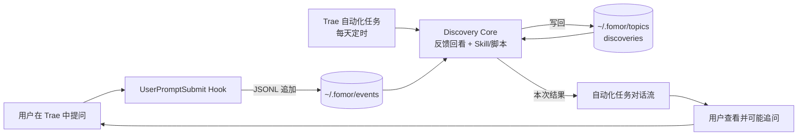

# Trae 平台能力调研（面向 Fomor）

> 目的：回答一个前提问题——**Fomor 作为「适配 Trae 的插件」，在 Trae 上到底能做什么、不能做什么、应该怎么落地。**
> 调研时间：2026-11-25。平台能力会变化，关键结论请在立项前用实验复核（见文末实验清单）。
> 关联文档：[PRD](./PRD.md)、[待确认问题](./OPEN-QUESTIONS.md)。

---

## 一、结论先行

1. **采集链路成立，采用「插件 + Hook + 自动化任务」三段式。** Trae 的 `UserPromptSubmit` Hook 能在用户发送消息后、智能体处理前拿到 `prompt` 与 `session_id`，这正是 PRD 需要的 UserMessage Hook。但 Hook 配置需要在设置中显式创建/启用，项目 Hook 还要求目录信任，**插件包能否自动安装 Hook 目前没有公开依据，必须验证**。
2. **Trae 自带「自动化任务」，可以替代自建调度器。** 插件市场中的插件以 Skills + MCP Server + Connector + 多平台二进制为主，适合「被调用」；但 Agent 窗口提供 Automation（固定时间/间隔/自然语言触发、本地或云端运行、执行历史）。**Fomor 不需要自建常驻服务，把定时分析交给自动化任务即可。**
3. **会话上下文读取是当前最大的不确定项。** CLI 的会话以本地 JSONL 形式存在（第三方资料），IDE 侧只有本地数据目录线索，**没有公开 API**。如果无法稳定按 `session_id` 读取，MVP 应直接砍掉「按需读取会话历史」，保留不确定性输出。
4. **交付可以只依赖自动化任务输出。** 当前版本不需要独立 APP、IM、MCP 面板，也不建议做独立网页：Discovery 直接生成在自动化任务对话流中，用户在执行历史里回看，并在 Trae 中自然追问。
5. **隐式反馈成立，但依赖时间模型。** 次日分析先回看观察窗内的提问：有强/弱兴趣就移入长期记忆，无相关提问则到期删除。前提是 Hook 能持续记录、且能正确把新提问归因到昨日 Discovery。

一句话建议：

> 用 **Trae Hook 做采集**，用 **Trae 自动化任务做调度、反馈回看与分析**，用 **`~/.fomor/`** 的文件做长期记忆，结果直接输出到自动化任务对话流；MVP 不做独立网页。

---

## 二、调研范围与方法

| 来源类型 | 内容 | 可信度 |
| --- | --- | --- |
| Trae 官方文档（中文/英文） | Hooks、Skills、插件市场、MCP、记忆、CLI、模式与窗口 | 高 |
| 本地已安装的官方插件包 | `.trae-plugin/plugin.json`、`.mcp.json`、`connector.json` 等实际结构 | 高（但属于实现观察，不是规范承诺） |
| 第三方逆向/社区资料 | CLI 会话存储路径（`~/.trae/cli/sessions/...`） | 中，需实测 |
| 未找到公开依据的部分 | 插件能否携带 Hook、IDE 会话历史读取接口、自动化任务云端能否访问本机 `~/.fomor/`、备份与迁移行为 | 低，列为待验证 |

> 注意：Trae 同时存在国内版与国际版，Hook/Skill 配置目录存在 `~/.trae-cn` 与 `~/.trae` 的差异；Fomor 数据目录统一为 `~/.fomor/`，不受版本影响。

---

## 三、Trae 产品形态

### 3.1 客户端与窗口

- **三种客户端**：桌面端、Web 端、移动端；项目、任务、交付物可在同一工作流中同步。
- **桌面端两个窗口**：
  - **Agent 窗口**：以任务为中心，可并行管理多个 Agent 任务，支持把长任务交给云端。
  - **IDE 窗口**：传统开发工作区，保留完整控制。
- **两种模式**：IDE 模式与 SOLO 模式（AI 主导，自动规划并完成需求理解、代码生成、测试、预览、部署）。

### 3.2 对 Fomor 的含义

| 形态 | 是否适合作为首发 | 原因 |
| --- | --- | --- |
| IDE 窗口 | 适合 | Hook 配置、工作区、Skills 都围绕 IDE/Agent 会话；开发者也主要在这里 |
| Agent 窗口 | 适合 | 用户任务发生地，会话更集中 |
| SOLO / Trae Work | 需单独评估 | 有独立 Skills 体系（`SKILL.md`）与任务模型，Hook 能力需确认 |
| Trae CLI | 可选：调试与批量评测 | 提供非交互 `exec`、`resume`、`mcp-server`、`app-server` |
| 移动/Web | 不适合首发 | 采集与本地文件能力受限 |

### 3.3 自动化任务（Automation）

Trae 的 Agent 窗口与 TraeWork 均提供「自动化」能力，可以创建定时任务，按设定时间或频率自动执行预设任务并生成结果。

**触发方式**

- 固定时间：每天 / 每周 / 每月的固定时间点；
- 间隔触发：按分钟 / 小时 / 天的固定间隔循环；
- 自定义：用自然语言描述（如「工作日早上 9 点」），仅「在对话中创建」方式支持。

**创建方式**

| 方式 | 说明 |
| --- | --- |
| 在对话中创建 | 输入「任务内容 + 执行时间」，AI 解析并创建；运行模式默认当前 Work/Code 模式且不可改 |
| 手动新建 | 配置任务名称、触发时间、任务内容、运行模式（Work/Code）、运行环境（云端/本地）、输出内容存储位置 |
| 从模板创建 | 使用内置模板（如每日简报、周报、竞品追踪）后修改 |

**执行与限制**

- 本地任务仅在电脑保持唤醒时运行；云端任务可在电脑锁屏或睡眠状态下运行；
- 任务创建后，**运行模式、运行环境、输出内容存储位置不可修改**，只能删除重建；
- 可在「执行历史」查看记录，点击记录跳转到对应对话流；
- 任务每次执行通常生成独立的对话记录，不应依赖上一次任务会话的上下文。

**对 Fomor 的含义**

| 需求 | 自动化任务能否承担 | 备注 |
| --- | --- | --- |
| 每天定时触发分析 | ✅ | 固定时间或间隔均可 |
| 长时间无人值守 | ⚠️ | 03:00 本地任务遇睡眠不会执行；云端可锁屏运行，但可能读不到本机 `~/.fomor/` |
| 读取 Hook 写入的本地事件 | ⚠️ | 取决于运行环境；本地最稳 |
| 生成并展示 Discovery | ✅ | 直接输出在任务对话流 |
| 持久化 Topic / Discovery | ✅ | 由任务中的脚本/Skill 写回 `~/.fomor/` |
| 收集隐式反馈 | ✅（有条件） | 次日任务回看 Hook 记录的用户提问；需要归因规则 |
| 修改任务配置 | ⚠️ | 运行环境、模式、输出位置创建后不可改 |

推荐配置：**任务内容调用 Fomor 分析 Skill；每天 03:00 触发一次；运行环境优先本地；输出位置指向 `~/.fomor/reports/` 或任务可读的等价路径。** 之所以选 03:00：用户通常不在使用，观察窗能覆盖前一整天，第二天凌晨先回看昨日反馈再生成新结果。

但 03:00 有一个硬冲突：**本地任务要求电脑保持唤醒**。如果没有配置系统定时唤醒（`pmset` / `rtcwake` / Windows 任务计划），任务很可能不执行。解决顺序建议：

1. 03:00 + 系统定时唤醒 + 本地数据（最符合当前设计，但需要改电源设置）；
2. 03:00 + 云端运行 + 数据同步（保留时间，但数据要离开本机）；
3. 改到用户通常开机的时段（如 09:00），本地运行；
4. 03:00 定时尝试 + 首次唤醒/登录补跑（需要额外的开机脚本或 SessionStart Hook，注意 Hook 必须快速返回）。

---

## 四、扩展能力全景

| 能力 | 作用 | 与 Fomor 的关系 |
| --- | --- | --- |
| **Hooks** | 在会话生命周期节点执行 Shell，读写 JSON | **采集主通道**（UserPromptSubmit） |
| **自动化任务** | 定时/间隔触发 Agent 任务，生成结果与执行历史 | **调度与输出主通道** |
| **Skills** | `SKILL.md` 封装的指令/脚本/资源，按需加载 | 安装引导、手动触发探索、查看报告 |
| **插件市场** | 分发插件（可含 Skills、MCP、Connector、binaries） | **分发入口** |
| **MCP** | 向 Agent 暴露工具/资源 | 后续可选（当前版本不做） |
| **自定义智能体 / Subagent** | 配置 Prompt、MCP、工具 | 可选的「探索执行器」，但非必需 |
| **Rules / Memories / Commands** | 规则、记忆、斜杠命令 | 可复用的偏好与入口；不建议把 Topic 存进 Memory |
| **CLI** | 非交互执行、会话恢复、插件管理、MCP/ACP/App Server | **调试/评测工具**，非当前运行必需 |
| **连接器（Connector）** | OAuth 等第三方授权 | 仅当 Fomor 需要外部服务时使用 |

---

## 五、Hooks：采集链路的核心

### 5.1 支持的事件（仅 6 类）

| 事件 | 触发时机 | 对 Fomor 的用途 |
| --- | --- | --- |
| `SessionStart` | 创建 Session 后、第一个对话前 | 可用于初始化/探测环境；**不用于注入上下文**（PRD 明确禁止） |
| `UserPromptSubmit` | 用户发送消息后、智能体处理前 | **记录用户问题**（核心） |
| `PreToolUse` | 工具调用前 | 可选：记录工具行为（MVP 不需要） |
| `PostToolUse` | 工具调用后 | 可选：记录执行结果（MVP 不需要） |
| `Stop` | 智能体准备结束当前 Query | 可选：作为「一轮结束」信号，触发本地队列 flush |
| `Notification` | 等待确认或任务完成，异步不阻塞 | 可选：作为提醒/交付时机 |

**关键缺口：没有 `SessionEnd`。** 因此「每天分析」不能依赖会话结束事件。当前方案是交给 **Trae 自动化任务**（固定时间/间隔触发），Hook 侧只负责把事件快速落盘。

### 5.2 配置位置

| 类型 | macOS / Linux | Windows | 作用范围 |
| --- | --- | --- | --- |
| 全局 Hook（国内版） | `~/.trae-cn/hooks.json` | `%userprofile%/.trae-cn/hooks.json` | 当前用户所有工作区 |
| 项目 Hook | `<project>/.trae/hooks.json` | 同左 | 当前项目/工作区 |
| Claude Code 全局 | `~/.claude/settings.json` | `%userprofile%/.claude/settings.json` | 兼容读取 |
| Claude Code 项目 | `<project>/.claude/settings.json`、`settings.local.json` | 同左 | 兼容读取 |

> 多个配置共存时会**合并执行**：一个工作区含多个项目根目录时，各项目 Hook 都会执行；同时启用 Claude Code Hook 与 TRAE Hook 时也会合并。**这是重复采集的主要来源，必须做去重。**

### 5.3 配置格式

```json
{
  "version": 1,
  "hooks": {
    "UserPromptSubmit": [
      {
        "hooks": [
          {
            "type": "command",
            "command": "/path/to/fomor collect",
            "timeout": 10
          }
        ]
      }
    ]
  }
}
```

- `matcher` 仅对 `PreToolUse` / `PostToolUse` / `Notification` 有效；
- `loop_limit` 仅对 `Stop` 有效，默认 5；
- 当前 `type` 仅支持 `command`。

### 5.4 输入（stdin）

通用字段：

```json
{
  "session_id": "string",
  "cwd": "/path/to/workspace",
  "hook_event_name": "UserPromptSubmit",
  "workspace_roots": ["/path/to/workspace"]
}
```

`UserPromptSubmit` 额外字段：

```json
{
  "prompt": "用户提交的 Prompt 文本"
}
```

> 官方文档未说明 `prompt` 是否包含 `@文件` 展开内容、图片、粘贴内容或斜杠命令参数。需要用真实输入实测（Q-PLAT-03）。

### 5.5 输出（stdout）与退出码

- **纯文本**：仅 `SessionStart`、`UserPromptSubmit` 会作为附加上下文交给模型。
- **JSON**：可返回 `continue`、`stopReason`、`decision`、`hookSpecificOutput.additionalContext` 等。
- **退出码 0**：正常，stdout 被解析。
- **退出码 2**：阻断性错误；对 `UserPromptSubmit` 等价于 `decision: "block"`，会**阻止用户请求**。
- **其他退出码**：非阻断，输出被忽略。

**对 Fomor 的硬约束：**

1. 采集 Hook **绝不能返回退出码 2**，否则会拦截用户正常提问。
2. 采集 Hook **不要输出 `additionalContext`**，否则违反「不向 Agent 注入内容」的产品原则。
3. 最安全的实现：只写本地队列，**stdout 为空、退出码 0**，`timeout` 设为 5–10 秒。

### 5.6 执行环境

| 项 | 说明 |
| --- | --- |
| Shell | macOS/Linux 默认 Bash；Windows 默认 PowerShell |
| 环境变量 | `TRAE_PROJECT_DIR`、`CLAUDE_PROJECT_DIR`（均为工作区目录） |
| 工作目录 | 全局 Hook：单工作区为根目录，多工作区为第一个工作区根目录；项目 Hook：配置文件所在项目根目录 |
| 运行方式 | **沙箱运行**（受限）或 **本地自动运行**（可访问本地环境，有安全风险） |

**对 Fomor 的含义**：采集事件写入 `~/.fomor/`；分析由自动化任务执行，不需要常驻服务。但 Hook 通常需要「本地自动运行」才能写该目录，这会触发平台安全警示，影响安装体验。必须在 MVP 前实测沙箱能否写入该目录（Q-PLAT-08）。

### 5.7 安全与运维

- 项目 Hook 需目录信任并手动启用；
- 全局 Hook 需在「设置 > Hooks」创建并确认安全警示；
- 可在设置中查看 Hook 运行日志（输出面板 → Agent Hooks）；
- 退出 Trae 后，当前周期 Hook 日志会被清空。

### 5.8 生命周期

```text
Session 创建
  → SessionStart
  → UserPromptSubmit
  → PreToolUse → [工具执行] → PostToolUse
  → （更多工具调用则循环）
  → Stop
  → Notification（异步）
```

### 5.9 对 Fomor 的 Hook 设计建议

| 设计项 | 建议 |
| --- | --- |
| 事件 | 只用 `UserPromptSubmit`；如需要轮次边界，再加 `Stop` |
| 命令 | `fomor-hook collect`（独立小二进制，启动快） |
| 耗时 | < 100ms 为目标，硬超时 5s |
| 写入 | 追加到本地 JSONL + 原子 rename；失败写 fallback 日志 |
| 去重键 | `platform + session_id + sha256(prompt) + 时间窗` |
| 输出 | 空 stdout，退出码 0 |
| 失败 | 永不阻断；不返回退出码 2 |
| 多 Hook | 安装器检测已存在的 Fomor Hook，避免重复注册 |

---

## 六、Skills：最适合承载「入口」和「引导」

### 6.1 基本结构

一个 Skill 是一个目录，必须包含 `SKILL.md`：

```text
skill-name/
├── SKILL.md
├── examples/
├── templates/
└── resources/
```

`SKILL.md` 使用 YAML Frontmatter + Markdown：

```markdown
---
name: 技能名称
description: 技能功能与适用场景
user-invocable: true
disable-model-invocation: false
---
# 技能名称
## 描述
## 使用场景
## 指令
## 示例（可选）
```

### 6.2 存放位置

| 类型 | 位置 |
| --- | --- |
| 项目技能 | `<workspace>/.trae/skills/{skill_name}` |
| 全局技能（国内版） | `~/.trae-cn/skills/{skill_name}` |
| 全局技能（国际版） | `~/.trae/skills/{skill_name}` |
| 开放生态 | `.agents/skills/`（需在设置中启用） |

> 项目技能只有在可信目录中才会被加载。

### 6.3 与 Fomor 的结合

建议提供 2–3 个 Skill，而不是一个大而全的 Skill：

| Skill | 触发场景 | 作用 |
| --- | --- | --- |
| `fomor-setup` | 用户说「安装/配置 Fomor」 | 检查 Hook、数据目录、权限，输出安装状态 |
| `fomor-review` | 用户说「看看最近有什么探索」 | 读取本地 Discovery 并渲染摘要 |
| `fomor-review` | 用户说「看看最近有什么探索」 | 读取本地 pending/reports 并渲染摘要 |
| `fomor-feedback` | 后续可选 | 手动写反馈；当前版本由次日回看自动推断，不提供入口 |

Skill 的定位是**交互入口与流程说明**，不承担后台计算。

---

## 七、插件市场与插件包

### 7.1 官方对插件的定义

- 插件是「面向特定任务场景封装的能力组件」；
- 安装后，智能体可在授权范围内调用对应服务；
- **部分插件集成了 MCP Server 和 Skill**；
- 用户可在对话前通过 `/` 选择本次任务所需的插件；
- 涉及第三方服务的插件可能需要 OAuth 授权。

### 7.2 实际插件包结构（本地安装包观察）

```text
plugin/
├── .trae-plugin/
│   └── plugin.json          # 插件清单
├── INSTRUCTIONS.md          # 给模型的说明（可选）
├── skills/                  # Skills 目录（可选）
├── .mcp.json                # MCP Server 定义（可选）
├── connector.json           # OAuth/连接器定义（可选）
├── bin/                     # 多平台二进制（可选）
└── assets/                  # 图标等
```

`plugin.json` 中已观察到的字段：

| 字段 | 作用 |
| --- | --- |
| `name` / `version` / `description` | 基本信息 |
| `i18n` | 多语言展示名与描述 |
| `author` / `homepage` / `repository` / `license` / `keywords` | 元信息 |
| `instructions` | 指向说明文件 |
| `skills` | 指向 Skills 目录 |
| `mcp` | 指向 MCP 配置 |
| `connector` | 指向连接器配置 |
| `binaries` | **多平台二进制**（含 sha256、下载地址、平台矩阵） |
| `env` | 从连接器注入的环境变量 |
| `interface` | 展示名、分类、能力标签、图标、默认 Prompt、隐私/服务条款链接等 |

`binaries` 示例（节选）：

```json
{
  "binaries": [
    {
      "name": "fomor-cli",
      "path": "bin/fomor",
      "required": true,
      "executable": true,
      "platforms": {
        "darwin-arm64": { "sha256": "...", "file_size": 123, "urls": [{ "source_group": "cn", "url": "..." }] }
      }
    }
  ]
}
```

`mcp` 示例：

```json
{
  "mcpServers": {
    "fomor": {
      "command": "node",
      "args": ["./server.bundle.cjs"]
    }
  }
}
```

### 7.3 未观察到 / 未公开的部分

- **`plugin.json` 中没有发现 `hooks` 字段**；
- 没有公开文档说明插件可以自动写入 `~/.trae-cn/hooks.json` 或在安装时启用 Hook；
- 没有公开文档说明 `binaries` 能否被 Hook 直接调用、升级时是否保留；当前版本不依赖二进制常驻。

> 这三点直接决定 Fomor 的安装体验与后台运行模型，必须优先做实验（Q-PLAT-02 / Q-PLAT-11）。

### 7.4 对 Fomor 的打包建议

```text
fomor/
├── .trae-plugin/
│   └── plugin.json            # 清单：skills（+ 可选 binaries）
├── INSTRUCTIONS.md            # 采集范围、隐私、使用入口
├── skills/
│   ├── fomor-setup/SKILL.md   # 安装与 Hook 自检
│   └── fomor-analyze/SKILL.md # 自动化任务调用的分析流程
└── bin/                       # 可选：Hook 采集小工具
    ├── fomor-linux-x64
    ├── fomor-darwin-arm64
    └── fomor-win32-x64.exe
```

用户数据不放在插件包内，统一写到 `~/.fomor/`（见 11.4）。

插件负责「被发现、被安装、被调用」；Hook 注册由 `fomor-setup` Skill 或采集小工具引导完成；当前版本不包含 MCP Server。

---

## 八、MCP：后续可选的「Trae 内交付」（当前版本不做）

> 当前版本已确定只用自动化任务输出。MCP 仅作为后续可选形态保留，下面是能力备忘。

### 8.1 Trae 对 MCP 的支持

- 插件可通过 `mcp` 字段携带 MCP Server；
- 本地 MCP 以 stdio 方式启动（`command` + `args`）；
- CLI 提供 `mcp` 管理命令，以及 `mcp-server`（以 stdio MCP Server 方式启动 CLI，供外部工具调用）；
- 自定义智能体可配置一个或多个 MCP Server。

### 8.2 Fomor 可以暴露的 MCP 工具（建议）

| 工具 | 作用 | 读写 |
| --- | --- | --- |
| `fomor_list_discoveries` | 列出最近 Discovery（按 Topic/时间过滤） | 只读 |
| `fomor_get_discovery` | 获取单条 Discovery 详情（问题理解、方案、证据） | 只读 |
| `fomor_list_topics` | 查看长期 Topic 与进度 | 只读 |
| `fomor_submit_feedback` | 提交反馈（感兴趣/已了解/不相关/已实践） | 写入 |
| `fomor_trigger_exploration` | 手动发起一次探索（可选） | 写入 |

### 8.3 优点与限制

**优点**

- 无需独立 APP，用户在 Trae 内即可查看与反馈；
- 与 Agent 工作现场一致，反馈链路短；
- 可复用 Trae 的对话 UI 与权限体系。

**限制**

- MCP 是「被调用」模式，不能主动推送；
- 主动提醒仍需 Notification Hook、系统通知或 IM；
- 需要保证 MCP Server 启动快、无副作用、可离线。

---

## 九、Trae CLI：最像「后台引擎」的部分

### 9.1 已确认的能力

| 能力 | 说明 |
| --- | --- |
| `traecli` | 交互式 TUI |
| `traecli exec` | **非交互式运行**，适合脚本/CI；支持 `--json`（JSONL 事件流）、`-o`（最后一条消息写文件）、`--output-schema`（约束输出结构） |
| `traecli resume` / `fork` | 恢复/复刻历史会话，支持 `--last`、`--all` |
| `traecli plugin` | 管理插件 |
| `traecli mcp` / `mcp-server` | 管理 MCP / 以 MCP Server 方式启动 |
| `traecli app-server` | 运行 app server，支持 `--remote` 远程连接 |
| `traecli acp` | 以 ACP（Agent Client Protocol）Server 运行，供外部客户端接入 |
| `traecli review` | 非交互代码评审 |
| `traecli sandbox` | 在沙箱中运行命令 |

通用参数包括 `--model`、`--sandbox`、`--ask-for-approval`、`--permission-mode`、`-C/--cd`、`-c key=value` 等。

### 9.2 对 Fomor 的三种用法

| 用法 | 说明 | 风险 |
| --- | --- | --- |
| **作为分析引擎** | Fomor 调用 `traecli exec --json --output-schema` 完成聚合/理解/生成 | 依赖用户已登录 CLI；成本与限流未知；需处理长耗时 |
| **作为调试/评测工具** | 用 CLI 批量跑三个案例，输出 JSON 便于对比 | 低 |
| **作为采集补充** | 通过 `resume`/会话文件读取历史 | 依赖未公开的本地格式，稳定性差 |

> 若采用 `exec`，务必使用 `--output-schema` 约束输出，避免模型自由文本导致解析失败。

### 9.3 会话存储（第三方资料，需实测）

- CLI 会话 rollout：`${TRAE_HOME:-~/.trae}/cli/sessions/YYYY/MM/DD/rollout-<timestamp>-<uuid>.jsonl`（压缩后为 `.jsonl.zst`）；
- 另有 `history.jsonl` 记录用户 prompts；
- `TRAE_HOME` 可覆盖默认根目录。

**注意**：这是第三方逆向文档的描述，不是官方承诺。IDE 侧的会话数据位于系统应用数据目录（如 macOS `~/Library/Application Support/Trae/ModularData`、Windows `%APPDATA%\Trae\ModularData`），官方仅用于故障排查说明，**不保证结构稳定，也不建议直接读写**。

---

## 十、其他可复用能力

### 10.1 Memories

| 类型 | 位置 | 说明 |
| --- | --- | --- |
| 全局记忆 | `~/.trae/memory/user_profile.md`（Windows 为 `%userprofile%/.trae/memory/`） | 跨项目偏好 |
| 项目记忆 | `~/.trae/memory/projects/{project_path}/project_memory.md` | 当前项目偏好 |

限制：**仅本地，不跨设备同步**；内容是给 Agent 的偏好/规则，不是结构化数据库。

**建议**：Fomor 的 Topic/Discovery 不要写入 Trae Memory；可以把「用户希望 Fomor 的探索偏好」摘要写入，但需用户显式同意。

### 10.2 Rules / Commands / 自定义智能体 / Subagent

- Rules：按生效方式注入上下文；
- Commands：斜杠命令入口；
- 自定义智能体：可配置 Prompt、MCP、内置工具；
- Subagent：把任务委派给专用子智能体，可限制工具与 MCP。

**建议**：MVP 不需要自定义智能体；如需「深度探索」长任务，可后续提供一个可选的 Subagent 配置。

### 10.3 连接器

- `connector.json` 定义 OAuth 连接器（如飞书、GitHub）；
- 插件可通过 `env` 把连接器凭证注入二进制。

**建议**：只有当 Fomor 要交付到 IM 或读取外部服务时才需要；MVP 可不做。

---

## 十一、Fomor 在 Trae 上的落地架构

### 11.1 四种方案对比

| 方案 | 组成 | 能否主动采集 | 能否定时分析 | 安装成本 | 结论 |
| --- | --- | --- | --- | --- | --- |
| A. 纯插件 | Skills + MCP | 否（只能被调用） | 否 | 低 | 不满足 PRD 核心 |
| B. 插件 + Hook | Skills + Hook 安装器 | 是 | 否 | 中 | 采集可行，分析需另解 |
| C. 插件 + Hook + 本地服务 | 插件 + Hook + 常驻服务 | 是 | 是 | 高 | 能力完整，但需要守护进程与升级维护 |
| **D. 插件 + Hook + 自动化任务** | 插件（Skills）+ Hook（采集）+ Trae 自动化任务（调度/分析/输出）+ `~/.fomor/`（记忆） | 是 | 是 | 中 | **当前选择**：无自建守护进程，交付仅靠任务输出 |

### 11.2 推荐架构



关键点：**插件目录、数据目录、Trae 目录三者分离**。插件升级只替换代码；数据在 `~/.fomor/`，不随插件升级或平台清理丢失。

### 11.3 PRD 模块到 Trae 机制的映射

| PRD 模块 | Trae 机制 | 说明 |
| --- | --- | --- |
| Collection Runtime | `UserPromptSubmit` Hook + 采集小工具 | Hook 只负责快速落盘；去重、补采在分析阶段处理 |
| Discovery Core | Trae 自动化任务中的 Skill/脚本 | 先回看上一批 Discovery 的反馈，再分析新事件；不常驻 |
| Memory Runtime | `~/.fomor/` 下的 JSON/JSONL | 不使用 Trae Memory，也不引入数据库 |
| Delivery Runtime | 自动化任务输出 | 对话流 + 执行历史；当前不做 APP/IM/MCP |
| 平台适配层 | `platform=trae` 的 Hook 适配器 | 未来可扩展到其他 Agent 平台 |

### 11.4 目录设计：插件与数据分离

插件目录只放代码与技能：

```text
fomor/
├── .trae-plugin/
│   └── plugin.json
├── skills/
│   └── fomor-analyze/
│       └── SKILL.md
└── bin/                     # 可选：Hook 采集小工具
```

用户数据放在用户主目录的独立目录：

```text
~/.fomor/                    # macOS/Linux；Windows 为 %userprofile%\.fomor\；可用 FOMOR_HOME 覆盖
├── config/
├── events/
│   └── 2026-11-25.jsonl
├── topics/
├── discoveries/
│   ├── pending/
│   └── promoted/
├── tombstones/              # 过期指纹，避免重复推荐
├── reports/                 # 本次输出副本；可选 HTML 日报
├── runtime/
├── backup/
└── logs/
```

与 PRD 的差别：Event 用 JSONL 追加，避免每日 JSON 数组重写导致并发问题；Topic/Discovery 仍用独立 JSON 文件。数据目录需 `0700`，不在插件目录留存用户数据。平台是否会清理未知子目录仍需实验（Q-MEM-11）。

### 11.5 独立网页是否更好？

结论：**MVP 不做独立网页**。

| 维度 | 独立网页 | 自动化任务输出 |
| --- | --- | --- |
| 验证核心假设 | 无直接帮助 | 直接看输出质量 |
| 隐式反馈 | 需额外埋点 | 用户在 Trae 内追问，Hook 自然记录 |
| 开发/部署 | 前端 + 后端 + 鉴权 + 同步 | 无 |
| 隐私 | 数据可能离开本机 | 数据只在本机 |
| 使用路径 | 多开一个页面 | 已在 Trae 中 |

如果后续需要更好的阅读与历史浏览，优先做**静态 HTML 日报**：任务结束时写入 `~/.fomor/reports/YYYY-MM-DD.html`，本地打开，无服务、无登录、不上传数据。只有当日活、留存和浏览需求被验证后，才考虑真正的 Web 应用。

---

## 十二、Trae 特有约束与风险

| # | 约束/风险 | 影响 | 缓解 |
| --- | --- | --- | --- |
| 1 | Hook 需手动启用 + 目录信任 | 安装转化率低 | 安装器检测 + 一键跳转设置 + 状态自检 Skill |
| 2 | 插件包未见 `hooks` 字段 | 无法随插件自动注册采集 | 由采集小工具写入/合并 `hooks.json`，或引导手动配置 |
| 3 | Hook 默认 30s 超时 | 长任务会失败甚至影响会话 | Hook 只落盘；分析全部交给自动化任务 |
| 4 | Hook 退出码 2 会阻断用户请求 | 严重体验事故 | 采集 Hook 永不返回 2；加保护开关 |
| 5 | Hook 合并执行 | 重复 Event | 全局去重键 + 安装器避免重复注册 |
| 6 | 无 `SessionEnd` | 无法用会话结束触发分析 | 已用 Trae 自动化任务解决 |
| 7 | 沙箱模式限制文件与进程 | 无法写 `~/.fomor/` | 需要本地自动运行；安装时明确说明 |
| 8 | 用户主目录权限与备份 | 共享设备或备份忽略隐藏目录 | `0700`；提供导出/备份；支持 `FOMOR_HOME` |
| 9 | IDE 会话历史无公开接口 | 按需上下文不可用 | MVP 降级为「只记录问题」，输出保留不确定性 |
| 10 | 03:00 本地任务与电脑睡眠冲突 | 凌晨机器通常休眠，任务不会执行 | 系统定时唤醒 + 本地；或云端 + 数据同步；或改白天 |
| 11 | 自动化任务云端运行可能读不到本机 `~/.fomor/` | 记忆与输出断裂 | 默认选本地；必须实测云端数据可达性 |
| 12 | 自动化任务的运行环境/模式/输出位置创建后不可改 | 选错只能重建 | 安装引导中固定推荐配置；提供检查清单 |
| 13 | 输出单向，反馈靠次日回看提问 | 归因错误会污染长期记忆 | 强/弱信号分档；无法判断时按无信号处理 |
| 14 | `~/.fomor/` 可能被用户清理或迁移遗漏 | 长期记忆丢失 | 独立目录 + 定期备份 + 导出入口 |
| 15 | 模型成本/限流未知 | 每日分析可能失败 | 预算控制、降级、缓存 |
| 16 | 隐私：Hook 读取用户输入 | 信任风险 | 明确采集范围、脱敏、可查看/清空 |
| 17 | 平台能力可能变化 | 长期维护成本 | 适配层隔离 + 版本探测 + 回归实验 |
| 18 | 观察窗与漏跑边界复杂 | 反馈丢失或重复升级 | 以运行时刻定义窗口；`last_evaluated_run_id` 幂等 |
| 19 | 独立网页会增加部署与隐私成本 | 拖慢核心验证 | MVP 只输出到任务对话流；后续静态 HTML |
| 20 | 03:00 同时要求本地数据与无人值守 | 两者天然冲突 | 需在「唤醒本机」「云端同步」「改时间」中做选择 |

---

## 十三、建议的验证顺序（与问题清单对应）

| 顺序 | 实验 | 要回答的问题 | 失败后的降级 |
| --- | --- | --- | --- |
| 1 | 在 IDE/Agent 窗口配置 `UserPromptSubmit`，打印 stdin | `prompt` 是否完整？`session_id` 是否稳定？ | 若不含附件，只记录文本并在 UI 标注 |
| 2 | 同时配置全局 + 项目 Hook | 是否重复触发？ | 去重键兜底 |
| 3 | 沙箱 vs 本地自动运行写 `~/.fomor/` | 权限是否足够？ | 改为工作区 `.fomor/` 或引导用户改模式 |
| 4 | 用安装器写 `hooks.json` | 能否自动注册？是否被平台覆盖？ | 改为手动引导 |
| 5 | 打包最小插件（Skill + 数据目录） | 能否安装、被调用、写文件？ | 改为手动放入 Skills 目录 |
| 6 | 创建每天 03:00 的自动化任务（本地运行） | 到点是否执行？能否调用 Skill？输出在哪？ | 改为纯 Prompt 任务 |
| 7 | 自动化任务选云端运行 | 能否读到本机 `~/.fomor/`？ | 固定本地，接受需唤醒 |
| 8 | 产生数据 → 备份 → 恢复 / 迁移 home | 数据是否完整、权限是否正确？ | 提供导出/导入脚本 |
| 9 | `traecli exec --json --output-schema` | 能否作为分析引擎？成本/延迟如何？ | 改用自有模型 API |
| 10 | 按 `session_id` 读 CLI 会话 | 能否稳定还原上下文？ | MVP 砍掉按需上下文 |
| 11 | 生成 Discovery → 次日提相关问题 → 再运行 | 能否正确 promoted？无关提问是否误判？ | 降级为关键词精确匹配 |
| 12 | 模拟漏跑 1/3/7 天、第 8 天追问、同日重跑 | 时间边界是否可靠？ | 扩大窗口 + 幂等标记 |
| 13 | 三个案例端到端 | 是否产生有启发的探索？ | 回炉 Problem Understanding |

---

## 十四、待验证 / 未证实清单

以下内容**没有找到公开、稳定的官方依据**，不要在产品文档或对外材料中当作确定能力：

1. 插件包可以携带并自动启用 Hook。
2. 插件安装后可自动写入 `~/.trae-cn/hooks.json`。
3. 自动化任务选云端运行时，能访问本机 `~/.fomor/`。
4. 自动化任务能稳定调用插件内的 Skill 或本地脚本。
5. 用户主目录被清理、换机或备份工具忽略隐藏目录时，`~/.fomor/` 仍可能丢失。
6. IDE 会话历史存在可通过 `session_id` 读取的公开接口。
7. `UserPromptSubmit.prompt` 包含 `@文件`、图片、长粘贴的完整内容。
8. 插件可直接调用 Trae 的模型额度（而非用户自带 Key 或 CLI 登录态）。
9. Hook 在 SOLO / Trae Work 形态下的行为与 IDE 一致。
10. 自动化任务在失败/超时后是否有平台级自动重试（目前只看到执行历史）。
11. 次日提问能被可靠归因到昨日 Discovery（强/弱信号阈值）。

---

## 十五、参考来源

### 官方文档

- [通过 Hook 实现自动化（TRAE CN）](https://docs.trae.cn/ide_automate-actions-with-hooks)
- [Hook 配置详解（TRAE CN）](https://docs.trae.cn/ide_hook-configuration-reference)
- [定时任务（TraeWork）](https://docs.trae.cn/work_automated-tasks)
- [自动化任务（TRAE IDE / Agent 窗口）](https://docs.trae.ai/ide/automated-tasks)
- [技能（Skill）（TRAE CN）](https://docs.trae.cn/ide_skills)
- [插件市场（TRAE CN）](https://docs.trae.cn/ide_marketplace)
- [TraeCode CLI 2.0 基础用法](https://docs.trae.cn/cli_basic-usage)
- [TraeCode CLI 2.0 命令行参数](https://docs.trae.cn/cli_command-line-parameters)
- [TraeCode CLI 快速开始](https://docs.trae.cn/cli_get-started-with-trae-cli-2)
- [Slash 命令（CLI）](https://docs.trae.cn/cli_slash-command)
- [Memories（TRAE）](https://docs.trae.ai/ide/memories?_lang=en)
- [Create and manage custom agents](https://docs.trae.ai/ide/agent?_lang=en)
- [Subagents](https://docs.trae.ai/ide/subagents)
- [About TRAE](https://docs.trae.ai/ide/what-is-trae)
- [Quickstart: IDE or SOLO mode](https://docs.trae.ai/ide/set-up-trae?_lang=en)
- [Automate with hooks（英文版）](https://docs.trae.ai/ide/automate-actions-with-hooks?_lang=en)
- [Hook configuration reference（英文版）](https://docs.trae.ai/ide/hook-configuration-reference)

### 本地安装包观察

- `trae-remote-official` 插件包：`.trae-plugin/plugin.json`、`.mcp.json`、`connector.json`、`binaries` 字段结构。

### 第三方资料（需实测）

- [TRAE CLI sessions 存储说明（deja-vu）](https://vshulcz.github.io/deja-vu/guide/delete-trae-sessions.html)
- [TRAE CLI memory 说明（deja-vu）](https://vshulcz.github.io/deja-vu/guide/memory-for-trae.html)
- [从终端到编辑器：TraeCode CLI 非交互模式实战（TRAE 社区）](https://forum.trae.cn/t/topic/178506)
