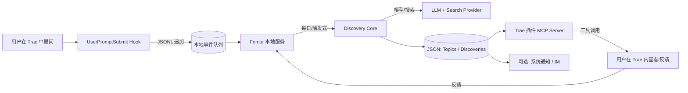

# Trae 平台能力调研（面向 Fomor）

> 目的：回答一个前提问题——**Fomor 作为「适配 Trae 的插件」，在 Trae 上到底能做什么、不能做什么、应该怎么落地。**
> 调研时间：2026-11-25。平台能力会变化，关键结论请在立项前用实验复核（见文末实验清单）。
> 关联文档：[PRD](./PRD.md)、[待确认问题](./OPEN-QUESTIONS.md)。

---

## 一、结论先行

1. **采集链路成立，但需要「插件 + Hook」两段式。** Trae 的 `UserPromptSubmit` Hook 能在用户发送消息后、智能体处理前拿到 `prompt` 与 `session_id`，这正是 PRD 需要的 UserMessage Hook。但 Hook 配置需要在设置中显式创建/启用，项目 Hook 还要求目录信任，**插件包能否自动安装 Hook 目前没有公开依据，必须验证**。
2. **Trae 的插件不是「常驻后台服务」。** 插件市场中的插件以 Skills + MCP Server + Connector + 多平台二进制为主，适合「被调用」；PRD 需要的「定时分析、长期运行」必须由自带的本地服务/CLI 承担，并解决安装、开机启动、退出与升级问题。
3. **会话上下文读取是当前最大的不确定项。** CLI 的会话以本地 JSONL 形式存在（第三方资料），IDE 侧只有本地数据目录线索，**没有公开 API**。如果无法稳定按 `session_id` 读取，MVP 应直接砍掉「按需读取会话历史」，保留不确定性输出。
4. **交付形态可以比 PRD 设想的更轻。** 除了独立 APP / IM，Trae 支持 MCP，可以把 Discovery 浏览与反馈做成 Trae 内的 MCP 工具；这对 MVP 的成本最低，也最贴近用户工作现场。

一句话建议：

> 用 **Trae 插件承载「入口与展示」**（Skills + MCP + 安装器），用 **本地常驻服务承载「采集、分析、记忆」**，用 **Hook 承载「无感采集」**。三者通过本地 JSON/HTTP 解耦。

---

## 二、调研范围与方法

| 来源类型 | 内容 | 可信度 |
| --- | --- | --- |
| Trae 官方文档（中文/英文） | Hooks、Skills、插件市场、MCP、记忆、CLI、模式与窗口 | 高 |
| 本地已安装的官方插件包 | `.trae-plugin/plugin.json`、`.mcp.json`、`connector.json` 等实际结构 | 高（但属于实现观察，不是规范承诺） |
| 第三方逆向/社区资料 | CLI 会话存储路径（`~/.trae/cli/sessions/...`） | 中，需实测 |
| 未找到公开依据的部分 | 插件能否携带 Hook、IDE 会话历史读取接口、插件二进制常驻生命周期 | 低，列为待验证 |

> 注意：Trae 同时存在国内版与国际版，配置目录存在 `~/.trae-cn` 与 `~/.trae` 的差异。下文同时标注。

---

## 三、Trae 产品形态

### 3.1 客户端与窗口

- **三种客户端**：桌面端、Web 端、移动端；项目、任务、交付物可在同一工作流中同步。
- **桌面端两个窗口**：
  - **Agent 窗口**：以任务为中心，可并行管理多个 Agent 任务，支持把长任务交给云端。
  - **IDE 窗口**：传统开发工作区，保留完整控制。
- **两种模式**：IDE 模式与 SOLO 模式（AI 主导，自动规划并完成需求理解、代码生成、测试、预览、部署）。

### 3.2 对 Fomor 的含义

| 形态 | 是否适合作为首发 | 原因 |
| --- | --- | --- |
| IDE 窗口 | 适合 | Hook 配置、工作区、Skills 都围绕 IDE/Agent 会话；开发者也主要在这里 |
| Agent 窗口 | 适合 | 用户任务发生地，会话更集中 |
| SOLO / Trae Work | 需单独评估 | 有独立 Skills 体系（`SKILL.md`）与任务模型，Hook 能力需确认 |
| Trae CLI | 适合做「后台分析引擎」或辅助采集 | 提供非交互 `exec`、`resume`、`mcp-server`、`app-server` |
| 移动/Web | 不适合首发 | 采集与本地文件能力受限 |

---

## 四、扩展能力全景

| 能力 | 作用 | 与 Fomor 的关系 |
| --- | --- | --- |
| **Hooks** | 在会话生命周期节点执行 Shell，读写 JSON | **采集主通道**（UserPromptSubmit） |
| **Skills** | `SKILL.md` 封装的指令/脚本/资源，按需加载 | 安装引导、手动触发探索、查看报告 |
| **插件市场** | 分发插件（可含 Skills、MCP、Connector、binaries） | **分发入口** |
| **MCP** | 向 Agent 暴露工具/资源 | **Trae 内查看 Discovery / 提交反馈** |
| **自定义智能体 / Subagent** | 配置 Prompt、MCP、工具 | 可选的「探索执行器」，但非必需 |
| **Rules / Memories / Commands** | 规则、记忆、斜杠命令 | 可复用的偏好与入口；不建议把 Topic 存进 Memory |
| **CLI** | 非交互执行、会话恢复、插件管理、MCP/ACP/App Server | **后台分析引擎 / 守护进程 / 调试工具** |
| **连接器（Connector）** | OAuth 等第三方授权 | 仅当 Fomor 需要外部服务时使用 |

---

## 五、Hooks：采集链路的核心

### 5.1 支持的事件（仅 6 类）

| 事件 | 触发时机 | 对 Fomor 的用途 |
| --- | --- | --- |
| `SessionStart` | 创建 Session 后、第一个对话前 | 可用于初始化/探测环境；**不用于注入上下文**（PRD 明确禁止） |
| `UserPromptSubmit` | 用户发送消息后、智能体处理前 | **记录用户问题**（核心） |
| `PreToolUse` | 工具调用前 | 可选：记录工具行为（MVP 不需要） |
| `PostToolUse` | 工具调用后 | 可选：记录执行结果（MVP 不需要） |
| `Stop` | 智能体准备结束当前 Query | 可选：作为「一轮结束」信号，触发本地队列 flush |
| `Notification` | 等待确认或任务完成，异步不阻塞 | 可选：作为提醒/交付时机 |

**关键缺口：没有 `SessionEnd`。** 因此「每天分析」不能依赖会话结束事件，必须自建调度（常驻进程 / 系统定时任务 / 下次启动补跑）。

### 5.2 配置位置

| 类型 | macOS / Linux | Windows | 作用范围 |
| --- | --- | --- | --- |
| 全局 Hook（国内版） | `~/.trae-cn/hooks.json` | `%userprofile%/.trae-cn/hooks.json` | 当前用户所有工作区 |
| 项目 Hook | `<project>/.trae/hooks.json` | 同左 | 当前项目/工作区 |
| Claude Code 全局 | `~/.claude/settings.json` | `%userprofile%/.claude/settings.json` | 兼容读取 |
| Claude Code 项目 | `<project>/.claude/settings.json`、`settings.local.json` | 同左 | 兼容读取 |

> 多个配置共存时会**合并执行**：一个工作区含多个项目根目录时，各项目 Hook 都会执行；同时启用 Claude Code Hook 与 TRAE Hook 时也会合并。**这是重复采集的主要来源，必须做去重。**

### 5.3 配置格式

```json
{
  "version": 1,
  "hooks": {
    "UserPromptSubmit": [
      {
        "hooks": [
          {
            "type": "command",
            "command": "/path/to/fomor collect",
            "timeout": 10
          }
        ]
      }
    ]
  }
}
```

- `matcher` 仅对 `PreToolUse` / `PostToolUse` / `Notification` 有效；
- `loop_limit` 仅对 `Stop` 有效，默认 5；
- 当前 `type` 仅支持 `command`。

### 5.4 输入（stdin）

通用字段：

```json
{
  "session_id": "string",
  "cwd": "/path/to/workspace",
  "hook_event_name": "UserPromptSubmit",
  "workspace_roots": ["/path/to/workspace"]
}
```

`UserPromptSubmit` 额外字段：

```json
{
  "prompt": "用户提交的 Prompt 文本"
}
```

> 官方文档未说明 `prompt` 是否包含 `@文件` 展开内容、图片、粘贴内容或斜杠命令参数。需要用真实输入实测（Q-PLAT-03）。

### 5.5 输出（stdout）与退出码

- **纯文本**：仅 `SessionStart`、`UserPromptSubmit` 会作为附加上下文交给模型。
- **JSON**：可返回 `continue`、`stopReason`、`decision`、`hookSpecificOutput.additionalContext` 等。
- **退出码 0**：正常，stdout 被解析。
- **退出码 2**：阻断性错误；对 `UserPromptSubmit` 等价于 `decision: "block"`，会**阻止用户请求**。
- **其他退出码**：非阻断，输出被忽略。

**对 Fomor 的硬约束：**

1. 采集 Hook **绝不能返回退出码 2**，否则会拦截用户正常提问。
2. 采集 Hook **不要输出 `additionalContext`**，否则违反「不向 Agent 注入内容」的产品原则。
3. 最安全的实现：只写本地队列，**stdout 为空、退出码 0**，`timeout` 设为 5–10 秒。

### 5.6 执行环境

| 项 | 说明 |
| --- | --- |
| Shell | macOS/Linux 默认 Bash；Windows 默认 PowerShell |
| 环境变量 | `TRAE_PROJECT_DIR`、`CLAUDE_PROJECT_DIR`（均为工作区目录） |
| 工作目录 | 全局 Hook：单工作区为根目录，多工作区为第一个工作区根目录；项目 Hook：配置文件所在项目根目录 |
| 运行方式 | **沙箱运行**（受限）或 **本地自动运行**（可访问本地环境，有安全风险） |

**对 Fomor 的含义**：若采集到 `~/.fomor`、并需要后续由常驻服务处理，通常需要「本地自动运行」；这会触发平台安全警示，影响安装体验。必须在 MVP 前实测沙箱能否写入用户目录（Q-PLAT-08）。

### 5.7 安全与运维

- 项目 Hook 需目录信任并手动启用；
- 全局 Hook 需在「设置 > Hooks」创建并确认安全警示；
- 可在设置中查看 Hook 运行日志（输出面板 → Agent Hooks）；
- 退出 Trae 后，当前周期 Hook 日志会被清空。

### 5.8 生命周期

```text
Session 创建
  → SessionStart
  → UserPromptSubmit
  → PreToolUse → [工具执行] → PostToolUse
  → （更多工具调用则循环）
  → Stop
  → Notification（异步）
```

### 5.9 对 Fomor 的 Hook 设计建议

| 设计项 | 建议 |
| --- | --- |
| 事件 | 只用 `UserPromptSubmit`；如需要轮次边界，再加 `Stop` |
| 命令 | `fomor-hook collect`（独立小二进制，启动快） |
| 耗时 | < 100ms 为目标，硬超时 5s |
| 写入 | 追加到本地 JSONL + 原子 rename；失败写 fallback 日志 |
| 去重键 | `platform + session_id + sha256(prompt) + 时间窗` |
| 输出 | 空 stdout，退出码 0 |
| 失败 | 永不阻断；不返回退出码 2 |
| 多 Hook | 安装器检测已存在的 Fomor Hook，避免重复注册 |

---

## 六、Skills：最适合承载「入口」和「引导」

### 6.1 基本结构

一个 Skill 是一个目录，必须包含 `SKILL.md`：

```text
skill-name/
├── SKILL.md
├── examples/
├── templates/
└── resources/
```

`SKILL.md` 使用 YAML Frontmatter + Markdown：

```markdown
---
name: 技能名称
description: 技能功能与适用场景
user-invocable: true
disable-model-invocation: false
---
# 技能名称
## 描述
## 使用场景
## 指令
## 示例（可选）
```

### 6.2 存放位置

| 类型 | 位置 |
| --- | --- |
| 项目技能 | `<workspace>/.trae/skills/{skill_name}` |
| 全局技能（国内版） | `~/.trae-cn/skills/{skill_name}` |
| 全局技能（国际版） | `~/.trae/skills/{skill_name}` |
| 开放生态 | `.agents/skills/`（需在设置中启用） |

> 项目技能只有在可信目录中才会被加载。

### 6.3 与 Fomor 的结合

建议提供 2–3 个 Skill，而不是一个大而全的 Skill：

| Skill | 触发场景 | 作用 |
| --- | --- | --- |
| `fomor-setup` | 用户说「安装/配置 Fomor」 | 检查 Hook、数据目录、权限，输出安装状态 |
| `fomor-review` | 用户说「看看最近有什么探索」 | 读取本地 Discovery 并渲染摘要 |
| `fomor-feedback` | 用户对某条 Discovery 反馈 | 写入反馈，更新 Topic |

Skill 的定位是**交互入口与流程说明**，不承担后台计算。

---

## 七、插件市场与插件包

### 7.1 官方对插件的定义

- 插件是「面向特定任务场景封装的能力组件」；
- 安装后，智能体可在授权范围内调用对应服务；
- **部分插件集成了 MCP Server 和 Skill**；
- 用户可在对话前通过 `/` 选择本次任务所需的插件；
- 涉及第三方服务的插件可能需要 OAuth 授权。

### 7.2 实际插件包结构（本地安装包观察）

```text
plugin/
├── .trae-plugin/
│   └── plugin.json          # 插件清单
├── INSTRUCTIONS.md          # 给模型的说明（可选）
├── skills/                  # Skills 目录（可选）
├── .mcp.json                # MCP Server 定义（可选）
├── connector.json           # OAuth/连接器定义（可选）
├── bin/                     # 多平台二进制（可选）
└── assets/                  # 图标等
```

`plugin.json` 中已观察到的字段：

| 字段 | 作用 |
| --- | --- |
| `name` / `version` / `description` | 基本信息 |
| `i18n` | 多语言展示名与描述 |
| `author` / `homepage` / `repository` / `license` / `keywords` | 元信息 |
| `instructions` | 指向说明文件 |
| `skills` | 指向 Skills 目录 |
| `mcp` | 指向 MCP 配置 |
| `connector` | 指向连接器配置 |
| `binaries` | **多平台二进制**（含 sha256、下载地址、平台矩阵） |
| `env` | 从连接器注入的环境变量 |
| `interface` | 展示名、分类、能力标签、图标、默认 Prompt、隐私/服务条款链接等 |

`binaries` 示例（节选）：

```json
{
  "binaries": [
    {
      "name": "fomor-cli",
      "path": "bin/fomor",
      "required": true,
      "executable": true,
      "platforms": {
        "darwin-arm64": { "sha256": "...", "file_size": 123, "urls": [{ "source_group": "cn", "url": "..." }] }
      }
    }
  ]
}
```

`mcp` 示例：

```json
{
  "mcpServers": {
    "fomor": {
      "command": "node",
      "args": ["./server.bundle.cjs"]
    }
  }
}
```

### 7.3 未观察到 / 未公开的部分

- **`plugin.json` 中没有发现 `hooks` 字段**；
- 没有公开文档说明插件可以自动写入 `~/.trae-cn/hooks.json` 或在安装时启用 Hook；
- 没有公开文档说明 `binaries` 启动后是否允许常驻、如何随 Trae 退出、如何升级。

> 这三点直接决定 Fomor 的安装体验与后台运行模型，必须优先做实验（Q-PLAT-02 / Q-PLAT-11）。

### 7.4 对 Fomor 的打包建议

```text
fomor-plugin/
├── .trae-plugin/
│   └── plugin.json            # 清单：skills + mcp + binaries
├── INSTRUCTIONS.md            # 简要说明：采集范围、隐私、入口
├── skills/
│   ├── fomor-setup/SKILL.md
│   ├── fomor-review/SKILL.md
│   └── fomor-feedback/SKILL.md
├── .mcp.json                  # 只读查询 + 反馈写入
├── bin/
│   ├── fomor-linux-x64
│   ├── fomor-darwin-arm64
│   └── fomor-win32-x64.exe
└── assets/
```

插件负责「被发现、被安装、被调用」；Hook 与守护进程由 `fomor` 二进制自行安装/管理，并在插件首次运行时引导用户完成授权。

---

## 八、MCP：最低成本的「Trae 内交付」

### 8.1 Trae 对 MCP 的支持

- 插件可通过 `mcp` 字段携带 MCP Server；
- 本地 MCP 以 stdio 方式启动（`command` + `args`）；
- CLI 提供 `mcp` 管理命令，以及 `mcp-server`（以 stdio MCP Server 方式启动 CLI，供外部工具调用）；
- 自定义智能体可配置一个或多个 MCP Server。

### 8.2 Fomor 可以暴露的 MCP 工具（建议）

| 工具 | 作用 | 读写 |
| --- | --- | --- |
| `fomor_list_discoveries` | 列出最近 Discovery（按 Topic/时间过滤） | 只读 |
| `fomor_get_discovery` | 获取单条 Discovery 详情（问题理解、方案、证据） | 只读 |
| `fomor_list_topics` | 查看长期 Topic 与进度 | 只读 |
| `fomor_submit_feedback` | 提交反馈（感兴趣/已了解/不相关/已实践） | 写入 |
| `fomor_trigger_exploration` | 手动发起一次探索（可选） | 写入 |

### 8.3 优点与限制

**优点**

- 无需独立 APP，用户在 Trae 内即可查看与反馈；
- 与 Agent 工作现场一致，反馈链路短；
- 可复用 Trae 的对话 UI 与权限体系。

**限制**

- MCP 是「被调用」模式，不能主动推送；
- 主动提醒仍需 Notification Hook、系统通知或 IM；
- 需要保证 MCP Server 启动快、无副作用、可离线。

---

## 九、Trae CLI：最像「后台引擎」的部分

### 9.1 已确认的能力

| 能力 | 说明 |
| --- | --- |
| `traecli` | 交互式 TUI |
| `traecli exec` | **非交互式运行**，适合脚本/CI；支持 `--json`（JSONL 事件流）、`-o`（最后一条消息写文件）、`--output-schema`（约束输出结构） |
| `traecli resume` / `fork` | 恢复/复刻历史会话，支持 `--last`、`--all` |
| `traecli plugin` | 管理插件 |
| `traecli mcp` / `mcp-server` | 管理 MCP / 以 MCP Server 方式启动 |
| `traecli app-server` | 运行 app server，支持 `--remote` 远程连接 |
| `traecli acp` | 以 ACP（Agent Client Protocol）Server 运行，供外部客户端接入 |
| `traecli review` | 非交互代码评审 |
| `traecli sandbox` | 在沙箱中运行命令 |

通用参数包括 `--model`、`--sandbox`、`--ask-for-approval`、`--permission-mode`、`-C/--cd`、`-c key=value` 等。

### 9.2 对 Fomor 的三种用法

| 用法 | 说明 | 风险 |
| --- | --- | --- |
| **作为分析引擎** | Fomor 调用 `traecli exec --json --output-schema` 完成聚合/理解/生成 | 依赖用户已登录 CLI；成本与限流未知；需处理长耗时 |
| **作为调试/评测工具** | 用 CLI 批量跑三个案例，输出 JSON 便于对比 | 低 |
| **作为采集补充** | 通过 `resume`/会话文件读取历史 | 依赖未公开的本地格式，稳定性差 |

> 若采用 `exec`，务必使用 `--output-schema` 约束输出，避免模型自由文本导致解析失败。

### 9.3 会话存储（第三方资料，需实测）

- CLI 会话 rollout：`${TRAE_HOME:-~/.trae}/cli/sessions/YYYY/MM/DD/rollout-<timestamp>-<uuid>.jsonl`（压缩后为 `.jsonl.zst`）；
- 另有 `history.jsonl` 记录用户 prompts；
- `TRAE_HOME` 可覆盖默认根目录。

**注意**：这是第三方逆向文档的描述，不是官方承诺。IDE 侧的会话数据位于系统应用数据目录（如 macOS `~/Library/Application Support/Trae/ModularData`、Windows `%APPDATA%\Trae\ModularData`），官方仅用于故障排查说明，**不保证结构稳定，也不建议直接读写**。

---

## 十、其他可复用能力

### 10.1 Memories

| 类型 | 位置 | 说明 |
| --- | --- | --- |
| 全局记忆 | `~/.trae/memory/user_profile.md`（Windows 为 `%userprofile%/.trae/memory/`） | 跨项目偏好 |
| 项目记忆 | `~/.trae/memory/projects/{project_path}/project_memory.md` | 当前项目偏好 |

限制：**仅本地，不跨设备同步**；内容是给 Agent 的偏好/规则，不是结构化数据库。

**建议**：Fomor 的 Topic/Discovery 不要写入 Trae Memory；可以把「用户希望 Fomor 的探索偏好」摘要写入，但需用户显式同意。

### 10.2 Rules / Commands / 自定义智能体 / Subagent

- Rules：按生效方式注入上下文；
- Commands：斜杠命令入口；
- 自定义智能体：可配置 Prompt、MCP、内置工具；
- Subagent：把任务委派给专用子智能体，可限制工具与 MCP。

**建议**：MVP 不需要自定义智能体；如需「深度探索」长任务，可后续提供一个可选的 Subagent 配置。

### 10.3 连接器

- `connector.json` 定义 OAuth 连接器（如飞书、GitHub）；
- 插件可通过 `env` 把连接器凭证注入二进制。

**建议**：只有当 Fomor 要交付到 IM 或读取外部服务时才需要；MVP 可不做。

---

## 十一、Fomor 在 Trae 上的落地架构

### 11.1 三种方案对比

| 方案 | 组成 | 能否主动采集 | 能否后台分析 | 安装成本 | 结论 |
| --- | --- | --- | --- | --- | --- |
| A. 纯插件 | Skills + MCP | 否（只能被调用） | 否 | 低 | 不满足 PRD 核心 |
| B. 插件 + Hook | Skills + MCP + Hook 安装器 | 是 | 否（Hook 非常驻） | 中 | 采集可行，分析需另解 |
| C. 插件 + Hook + 本地服务 | 插件（入口/展示）+ Hook（采集）+ 常驻服务（分析/记忆） | 是 | 是 | 高 | **推荐**，最符合 PRD |

### 11.2 推荐架构



### 11.3 PRD 模块到 Trae 机制的映射

| PRD 模块 | Trae 机制 | 说明 |
| --- | --- | --- |
| Collection Runtime | `UserPromptSubmit` Hook + 本地小二进制 | Hook 只负责快速落盘；去重、补采在服务侧 |
| Discovery Core | 本地常驻服务（Python/Node/Go） | 可调用 `traecli exec` 或自有模型 API |
| Memory Runtime | 本地 JSON（`~/.fomor`） | 不使用 Trae Memory 作为主存储 |
| Delivery Runtime | MCP Server（Trae 内）+ 可选通知/IM | MCP 负责查看与反馈；通知单独实现 |
| 平台适配层 | `platform=trae` 的 Hook 适配器 | 未来可扩展到其他 Agent 平台 |

### 11.4 建议的本地目录

```text
~/.fomor/
├── config/
│   ├── settings.json
│   └── preferences.json
├── events/
│   └── 2026-11-25.jsonl
├── topics/
├── discoveries/
├── runtime/
│   ├── tasks.json
│   └── state.json
├── logs/
└── bin/            # 由插件安装的 fomor 二进制
```

与 PRD 的差别：Event 用 JSONL 追加，避免每日 JSON 数组重写导致并发问题；Topic/Discovery 仍用独立 JSON 文件。

---

## 十二、Trae 特有约束与风险

| # | 约束/风险 | 影响 | 缓解 |
| --- | --- | --- | --- |
| 1 | Hook 需手动启用 + 目录信任 | 安装转化率低 | 安装器检测 + 一键跳转设置 + 状态自检 Skill |
| 2 | 插件包未见 `hooks` 字段 | 无法随插件自动注册采集 | 由 `fomor` 二进制写入/合并 `hooks.json`，或引导手动配置 |
| 3 | Hook 默认 30s 超时 | 长任务会失败甚至影响会话 | Hook 只落盘；分析全部异步 |
| 4 | Hook 退出码 2 会阻断用户请求 | 严重体验事故 | 采集 Hook 永不返回 2；加保护开关 |
| 5 | Hook 合并执行 | 重复 Event | 全局去重键 + 安装器避免重复注册 |
| 6 | 无 `SessionEnd` | 无法用会话结束触发分析 | 自建调度/补跑 |
| 7 | 沙箱模式限制文件与进程 | 无法写用户目录或启动服务 | 需要本地自动运行；安装时明确说明 |
| 8 | 国内外路径不同 | 安装器/文档分裂 | 运行时探测 `~/.trae-cn` / `~/.trae` |
| 9 | IDE 会话历史无公开接口 | 按需上下文不可用 | MVP 降级为「只记录问题」，输出保留不确定性 |
| 10 | 插件二进制常驻生命周期未知 | 后台服务可能被 Trae 退出带走 | 独立守护（launchd/systemd/计划任务），或随系统启动 |
| 11 | MCP 只能被调用 | 无法主动推送 | 结合 Notification Hook 或系统通知 |
| 12 | 模型成本/限流未知（`exec`） | 每日分析可能失败 | 预算控制、降级、缓存 |
| 13 | 隐私：Hook 读取用户输入 | 信任风险 | 明确采集范围、脱敏、可查看/清空 |
| 14 | 平台能力可能变化 | 长期维护成本 | 适配层隔离 + 版本探测 + 回归实验 |

---

## 十三、建议的验证顺序（与问题清单对应）

| 顺序 | 实验 | 要回答的问题 | 失败后的降级 |
| --- | --- | --- | --- |
| 1 | 在 IDE/Agent 窗口配置 `UserPromptSubmit`，打印 stdin | `prompt` 是否完整？`session_id` 是否稳定？ | 若不含附件，只记录文本并在 UI 标注 |
| 2 | 同时配置全局 + 项目 Hook | 是否重复触发？ | 去重键兜底 |
| 3 | 沙箱 vs 本地自动运行写 `~/.fomor` | 权限是否足够？ | 改为项目内 `.fomor/` 或引导用户改模式 |
| 4 | 用插件安装器写 `hooks.json` | 能否自动注册？是否被平台覆盖？ | 改为手动引导 |
| 5 | 打包最小插件（Skill + MCP） | 能否安装、启动、被调用？ | 退回本地 HTML 报告交付 |
| 6 | 插件二进制常驻 | 是否随 Trae 退出？能否开机自启？ | 独立守护进程/计划任务 |
| 7 | `traecli exec --json --output-schema` | 能否作为分析引擎？成本/延迟如何？ | 改用自有模型 API |
| 8 | 按 `session_id` 读 CLI 会话 | 能否稳定还原上下文？ | MVP 砍掉按需上下文 |
| 9 | 三个案例端到端 | 是否产生有启发的探索？ | 回炉 Problem Understanding |

---

## 十四、待验证 / 未证实清单

以下内容**没有找到公开、稳定的官方依据**，不要在产品文档或对外材料中当作确定能力：

1. 插件包可以携带并自动启用 Hook。
2. 插件安装后可自动写入 `~/.trae-cn/hooks.json`。
3. 插件 `binaries` 可以常驻运行、随系统开机自启、随 Trae 退出而退出。
4. IDE 会话历史存在可通过 `session_id` 读取的公开接口。
5. `UserPromptSubmit.prompt` 包含 `@文件`、图片、长粘贴的完整内容。
6. 插件可直接调用 Trae 的模型额度（而非用户自带 Key 或 CLI 登录态）。
7. MCP Server 可以在后台主动推送消息（目前看只能被动调用）。
8. Hook 在 SOLO / Trae Work 形态下的行为与 IDE 一致。

---

## 十五、参考来源

### 官方文档

- [通过 Hook 实现自动化（TRAE CN）](https://docs.trae.cn/ide_automate-actions-with-hooks)
- [Hook 配置详解（TRAE CN）](https://docs.trae.cn/ide_hook-configuration-reference)
- [技能（Skill）（TRAE CN）](https://docs.trae.cn/ide_skills)
- [插件市场（TRAE CN）](https://docs.trae.cn/ide_marketplace)
- [TraeCode CLI 2.0 基础用法](https://docs.trae.cn/cli_basic-usage)
- [TraeCode CLI 2.0 命令行参数](https://docs.trae.cn/cli_command-line-parameters)
- [TraeCode CLI 快速开始](https://docs.trae.cn/cli_get-started-with-trae-cli-2)
- [Slash 命令（CLI）](https://docs.trae.cn/cli_slash-command)
- [Memories（TRAE）](https://docs.trae.ai/ide/memories?_lang=en)
- [Create and manage custom agents](https://docs.trae.ai/ide/agent?_lang=en)
- [Subagents](https://docs.trae.ai/ide/subagents)
- [About TRAE](https://docs.trae.ai/ide/what-is-trae)
- [Quickstart: IDE or SOLO mode](https://docs.trae.ai/ide/set-up-trae?_lang=en)
- [Automate with hooks（英文版）](https://docs.trae.ai/ide/automate-actions-with-hooks?_lang=en)
- [Hook configuration reference（英文版）](https://docs.trae.ai/ide/hook-configuration-reference)

### 本地安装包观察

- `trae-remote-official` 插件包：`.trae-plugin/plugin.json`、`.mcp.json`、`connector.json`、`binaries` 字段结构。

### 第三方资料（需实测）

- [TRAE CLI sessions 存储说明（deja-vu）](https://vshulcz.github.io/deja-vu/guide/delete-trae-sessions.html)
- [TRAE CLI memory 说明（deja-vu）](https://vshulcz.github.io/deja-vu/guide/memory-for-trae.html)
- [从终端到编辑器：TraeCode CLI 非交互模式实战（TRAE 社区）](https://forum.trae.cn/t/topic/178506)
